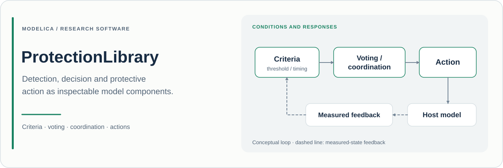

# ProtectionLibrary

**Reusable protection logic and physical measures for Modelica system experiments.**

**English** · [简体中文](README_zh.md)

[](package.mo)
[](package.mo)

[Purpose](#purpose) · [Implementation](#how-it-works) · [Quick start](#quick-start) · [Examples](#examples) · [Research use](#research-use)

## Purpose

ProtectionLibrary helps researchers represent the full path from a measured condition to a protective action: **qualify a criterion, combine channels, coordinate authority, act on the physical system, and observe whether the action occurred**.

Its components support studies of threshold selection, persistence, voting, degraded operation, interlocking, reset behaviour, electrical disconnection, braking, cooling and fluid isolation or relief. These functions can be assembled alongside a host plant and controller to examine protective behaviour during a transient.

The library keeps decision logic and physical measures separately accessible. This allows experiments to distinguish a correct trip decision from a delayed, refused or ineffective action, and to investigate the behaviour of the complete protection arrangement.

## At a glance

| Item | Current source |
| :--- | :--- |
| Modelica package | `ProtectionLibrary` |
| Declared version | **0.3.0**, in [package.mo](package.mo) |
| External Modelica dependency | **Modelica 4.0.0** |
| Starting example | [Examples.ThresholdLatchReset](Examples/ThresholdLatchReset.mo) |
| Included experiments | **9** models in [Examples](Examples) |
| Model inventory | [model-catalog.csv](model-catalog.csv) |
| Version history | [CHANGELOG.md](CHANGELOG.md) |
| Reviewed source baseline | [`b4cd813`](https://github.com/Ruizhe-Yang/ProtectionLibrary/commit/b4cd813e391ccfa50e02d075422c8ee724121b88), 12 November 2026 |

The version is read from the package annotation. Use a Git commit to identify the precise source snapshot behind an experiment.

## How it works

### Qualify conditions before coordinating action

[HighLimit](Criteria/HighLimit.mo) separates a trip threshold from its hysteretic reset threshold. [Persistence](Criteria/Persistence.mo) requires an uninterrupted qualified dwell. Their optional validity inputs and `failSafe` parameters make the handling of unqualified measurements explicit.

[TripLatch](Coordination/TripLatch.mo) gives a trip priority over a simultaneous reset; resetting requires a permitted reset edge. [ResetPermission](Coordination/ResetPermission.mo) generates that permission after a continuous safe dwell. [PrioritySelector](Coordination/PrioritySelector.mo) chooses commands in the order **emergency → protection → degraded → normal**.

These behaviours are visible model contracts, allowing the experiment to specify exactly when a request becomes actionable and when normal operation may resume.

### Voting includes channel qualification

Boolean voting offers common fixed arrangements and a configurable [MOutOfN](Voting/BooleanVoting/MOutOfN.mo). Invalid channels contribute according to `invalidVote`; `nValid`, `degraded` and `enoughValid` expose the available information.

Crucially, `enoughValid` is a diagnostic output: it does **not** automatically inhibit the Boolean vote `y`. Connect it to the coordination policy when insufficient valid channels should change the operating mode.

Analogue voting provides median, mean, weighted and trimmed combinations. [Median3](Voting/AnalogVoting/Median3.mo), for example, reports `available` and `nValid` and uses an explicit fallback when too few qualified measurements remain. A numerical fallback value should be interpreted together with `available`.

### A command and its outcome are different observations

[ActionMonitor](Coordination/ActionMonitor.mo) compares `command` with an independent `measuredAction` input. It reports `acknowledged`, `failed`, `late`, `unexpectedAction`, event times and a failure count.

Use a separately modelled or measured actuator response as feedback. A command signal alone cannot show whether the intended physical action occurred. The [ActionFeedbackAndFailure](Examples/ActionFeedbackAndFailure.mo) example demonstrates this distinction using two identical requests and different actuator responses.

### Physical measures retain engineering parameters

Electrical, mechanical, thermal and fluid measures expose their relevant constitutive parameters. [Disconnect](Electrical/Disconnect.mo) uses finite on-resistance and off-conductance. [IsolationValve](Fluid/IsolationValve.mo) represents opening dynamics and leakage; [ReliefValve](Fluid/ReliefValve.mo) combines differential-pressure hysteresis with a finite flow path. Such parameters determine the plant's post-trip response and belong in the experiment record.

## Package map

| Package | Main content |
| :--- | :--- |
| [Criteria](Criteria) | Limits, bands, persistence, rate, validity, disagreement, watchdog and sequence criteria |
| [Voting](Voting) | Qualified Boolean votes and analogue fusion |
| [Coordination](Coordination) | Latching, reset permission, authority, interlocks, fallback and action monitoring |
| [Electrical](Electrical) | Disconnection, dump load, source transfer, limiting and derating |
| [Mechanics](Mechanics) | Braking, stops, travel/overspeed guards and force/torque limiting |
| [Thermal](Thermal) | Cooling, isolation, heat-input limiting and temperature derating |
| [Fluid](Fluid) | Isolation, relief, bypass and flow limiting |
| [Utilities](Utilities) | Fusion functions, types and example helpers |
| [UsersGuide](UsersGuide) / [Examples](Examples) | In-tool guidance and experiment definitions |

## Quick start

Make **MSL 4.0.0** available in your Modelica tool and clone the repository:

```sh
git clone https://github.com/Ruizhe-Yang/ProtectionLibrary.git ProtectionLibrary
cd ProtectionLibrary
```

Load `package.mo` and open `ProtectionLibrary.Examples.ThresholdLatchReset`. Its experiment annotation specifies **0–6 s**, output interval **0.01 s**, tolerance **1e-6**.

For OpenModelica, save this as `quickstart.mos` in the repository root, then run `omc quickstart.mos`:

```modelica
loadModel(Modelica, {"4.0.0"});
loadFile("package.mo");
checkModel(ProtectionLibrary.Examples.ThresholdLatchReset);
simulate(ProtectionLibrary.Examples.ThresholdLatchReset,
  startTime=0, stopTime=6, numberOfIntervals=600,
  tolerance=1e-6);
getErrorString();
```

Inspect `signal.y`, `limit.request`, `persist.request`, `safeDwell.resetAllowed`, `reset.y` and `protectedState`. Follow the distinction between a raw threshold crossing, a sustained request, a latched trip and a permitted reset. Then run `ActionFeedbackAndFailure` to inspect the good and refused monitors' `acknowledged`, `failed` and event-time outputs.

## Examples

All names below belong to `ProtectionLibrary.Examples`.

| Example | Study and useful signals |
| :--- | :--- |
| [ThresholdLatchReset](Examples/ThresholdLatchReset.mo) | Hysteresis, persistence and reset permission; `protectedState` and the intermediate request/permission signals |
| [BooleanVoting](Examples/BooleanVoting.mo) | Fixed and configurable voting with invalid channels; the `*Request` outputs and each voter's `nValid`/`enoughValid` |
| [AnalogVoting](Examples/AnalogVoting.mo) | Median/mean with changing qualification; `median3Value`, `mean3Value`, `median5Value`, `mean5Value` and availability |
| [CommandPriorityAndInterlock](Examples/CommandPriorityAndInterlock.mo) | Ordered authority and delayed return of start permission; `selectedCommand`, `startAllowed` |
| [ElectricalTripAndDump](Examples/ElectricalTripAndDump.mo) | Disconnection and an inductive-energy dissipation path; `resistiveLoad.i`, `coil.i`, `dump.lossPower` |
| [MechanicalBraking](Examples/MechanicalBraking.mo) | Finite rotational/translational braking; `rotationBody.w`, `translationBody.v` |
| [ThermalCooling](Examples/ThermalCooling.mo) | Protected and reference thermal responses; `protectedBody.T`, `referenceBody.T`, `hot.request` |
| [FluidIsolationAndRelief](Examples/FluidIsolationAndRelief.mo) | Isolation and an independently connected relief branch; `protectedVolume.medium.p`, `referenceVolume.medium.p`, `relief.massFlow`, `isolation.opening` |
| [ActionFeedbackAndFailure](Examples/ActionFeedbackAndFailure.mo) | Identical requests with successful/refused responses; `goodMonitor` and `refusedMonitor` diagnostics |

## Research use

A useful study records both the **decision sequence** and the **physical response**. Compare protected and reference configurations under the same disturbance, then inspect detection time, voting qualification, selected authority, commanded action, observed action and the residual plant response.

Record the **repository URL, source version, commit, fully qualified model, thresholds, delays, reset policy, validity/fallback choices, actuator parameters, initial conditions, tool/MSL versions and solver settings**. Cite the snapshot actually used. Distinguish a protection request from observed actuation when reporting success or failure.

### Scope and assumptions

- Device models are configurable engineering abstractions. Their resistances, leakage, thermal conductances and actuation dynamics must suit the host plant.
- Logic definitions do not assign failure probabilities, diagnostic coverage or a safety integrity level.
- A component's modelled state output describes its implemented equations; independent sensing and actuator-failure hypotheses must be represented where the research question requires them.
- The nine examples exercise selected configurations, rather than establishing all combinations of protection logic and plants.

## Development and licensing

A useful issue includes a small plant, the input/validity sequence, expected trip/reset/action timing, parameter settings and tool/MSL versions. Contributions should preserve the separation between requests, authority decisions, physical actions and outcome feedback.

See [LICENSE](LICENSE) for repository licensing and [CHANGELOG.md](CHANGELOG.md) for migration details.
