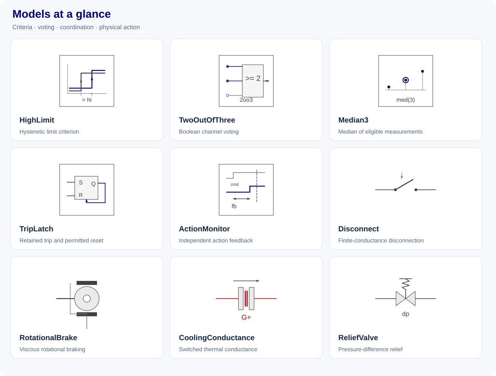

# ProtectionLibrary

**Protection components for Modelica simulations.**

English · [简体中文](README.zh-CN.md)

ProtectionLibrary provides criteria, Boolean and analogue voting, command coordination, physical protective devices and action monitoring. Explicit signal and physical interfaces support the construction of protection chains and comparison of requested actions with model responses.

**Version:** 1.0.0 · **Requires:** Modelica Standard Library 4.0.0

## Documentation

- [User Guide](docs/UserGuide.md) — installation, tutorials and complete model reference.
- [中文使用手册](docs/UserGuide.zh-CN.md)

## Licence

[GNU General Public License v3](LICENSE).
