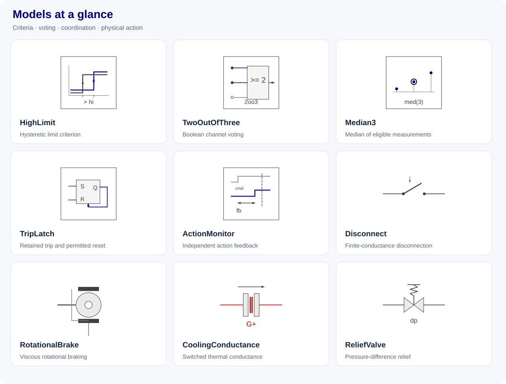

# ProtectionLibrary

**面向 Modelica 仿真的保护组件库。**

[English](README.md) · 简体中文

ProtectionLibrary 提供判据、布尔与模拟量表决、命令协调、物理保护元件及动作监视。通过明确的信号和物理接口构建保护链，并对照动作请求与模型响应。

**版本：** 1.0.0 · **依赖：** Modelica Standard Library 4.0.0

## 文档

- [English User Guide](docs/UserGuide.md) — 默认英文手册。
- [中文使用手册](docs/UserGuide.zh-CN.md) — 安装、教程及完整模型参考。

## 许可证

[GNU General Public License v3](LICENSE)。
