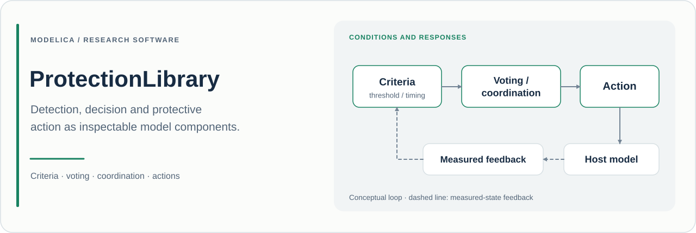

# ProtectionLibrary

**面向 Modelica 系统实验的可复用保护逻辑与物理措施。**

[English](README.md) · **简体中文**

[](package.mo)
[](package.mo)

## 项目目的

ProtectionLibrary 用于表达从测量条件到保护动作的完整过程：**形成有效判据、组合多个通道、协调控制权限、作用于物理系统，并观察动作是否实际发生**。

库内元件支持阈值选择、持续时间判定、表决、降级运行、联锁、复位、电气断开、制动、冷却以及流体隔离/泄压研究。这些功能可以与宿主本体及控制器共同装配，分析瞬态过程中的保护行为。

决策逻辑与物理措施分别提供，便于区分正确的保护决策与延迟、拒绝或效果不足的执行动作，从而研究完整保护配置的表现。

## 当前源码概况

| 项目 | 内容 |
| :--- | :--- |
| Modelica 包名 | `ProtectionLibrary` |
| 声明版本 | **0.3.0**，见 [package.mo](package.mo) |
| 外部 Modelica 依赖 | **Modelica 4.0.0** |
| 推荐起点 | [Examples.ThresholdLatchReset](Examples/ThresholdLatchReset.mo) |
| 示例数量 | [Examples](Examples) 中的 **9** 个实验模型 |
| 模型索引 | [model-catalog.csv](model-catalog.csv) |
| 版本记录 | [CHANGELOG.md](CHANGELOG.md) |
| 说明核对基线 | [`b4cd813`](https://github.com/Ruizhe-Yang/ProtectionLibrary/commit/b4cd813e391ccfa50e02d075422c8ee724121b88)；核对日期 2026-11-12 |

版本取自包注解。实验还应记录 Git 提交，以标识实际使用的源码快照。

## 实现方式

### 判据有效化与动作协调

[HighLimit](Criteria/HighLimit.mo) 将触发阈值与带滞回的恢复阈值分别设置。[Persistence](Criteria/Persistence.mo) 要求条件在有效状态下连续保持。可选有效性输入与 `failSafe` 参数明确了无效测量的处理方式。

[TripLatch](Coordination/TripLatch.mo) 在保护请求与复位同时出现时优先保持保护，复位要求获得许可的复位边沿。[ResetPermission](Coordination/ResetPermission.mo) 在连续安全保持一段时间后提供许可。[PrioritySelector](Coordination/PrioritySelector.mo) 按**紧急 → 保护 → 降级 → 正常**的次序选择指令。

这些行为均在模型中明确表达，便于实验规定请求何时转化为动作，以及何时允许恢复正常运行。

### 表决同时表达通道有效性

布尔表决提供常见固定结构及可配置的 [MOutOfN](Voting/BooleanVoting/MOutOfN.mo)。无效通道按 `invalidVote` 参与，`nValid`、`degraded` 和 `enoughValid` 则公开当前可用信息。

需要注意，`enoughValid` 是诊断输出，**不会自动抑制**布尔表决结果 `y`。如果有效通道不足需要改变运行模式，应将它显式连接到协调策略中。

模拟量表决提供中位数、均值、加权及截尾组合。例如，[Median3](Voting/AnalogVoting/Median3.mo) 输出 `available`、`nValid`，有效测量不足时使用明确的回退方式。数值回退输出应与 `available` 一并解释。

### 指令与动作结果分别观察

[ActionMonitor](Coordination/ActionMonitor.mo) 比较 `command` 与独立的 `measuredAction` 输入，输出 `acknowledged`、`failed`、`late`、`unexpectedAction`、事件时刻及失败计数。

应使用独立建模或测得的执行器响应作为反馈。仅有指令信号无法说明预期物理动作是否发生。[ActionFeedbackAndFailure](Examples/ActionFeedbackAndFailure.mo) 使用相同请求和不同执行器响应展示了这种区别。

### 物理措施保留工程参数

电气、机械、热及流体措施公开相应本构参数。[Disconnect](Electrical/Disconnect.mo) 使用有限导通电阻与断开电导。[IsolationValve](Fluid/IsolationValve.mo) 表达开度动态及泄漏；[ReliefValve](Fluid/ReliefValve.mo) 将压差滞回与有限流通路径结合。这些参数决定保护动作后的本体响应，应纳入实验记录。

## 包结构

| 包 | 主要内容 |
| :--- | :--- |
| [Criteria](Criteria) | 限值、区间、持续时间、变化率、有效性、差异、看门狗及顺序判据 |
| [Voting](Voting) | 考虑有效性的布尔表决与模拟量融合 |
| [Coordination](Coordination) | 锁存、复位许可、权限、联锁、回退及动作监测 |
| [Electrical](Electrical) | 断开、耗能负载、电源切换、限幅及降额 |
| [Mechanics](Mechanics) | 制动、停止、行程/超速保护及力/力矩限制 |
| [Thermal](Thermal) | 冷却、隔离、热输入限制及温度降额 |
| [Fluid](Fluid) | 隔离、泄压、旁路及流量限制 |
| [Utilities](Utilities) | 融合函数、类型及示例辅助模型 |
| [UsersGuide](UsersGuide) / [Examples](Examples) | 工具内说明与实验定义 |

## 快速开始

确保 Modelica 工具中的 **MSL 4.0.0** 可用，随后克隆仓库：

```sh
git clone https://github.com/Ruizhe-Yang/ProtectionLibrary.git ProtectionLibrary
cd ProtectionLibrary
```

加载 `package.mo` 并打开 `ProtectionLibrary.Examples.ThresholdLatchReset`。模型注解指定 **0–6 s**、输出间隔 **0.01 s**、容差 **1e-6**。

使用 OpenModelica 时，将以下内容保存为仓库根目录下的 `quickstart.mos`，运行 `omc quickstart.mos`：

```modelica
loadModel(Modelica, {"4.0.0"});
loadFile("package.mo");
checkModel(ProtectionLibrary.Examples.ThresholdLatchReset);
simulate(ProtectionLibrary.Examples.ThresholdLatchReset,
  startTime=0, stopTime=6, numberOfIntervals=600,
  tolerance=1e-6);
getErrorString();
```

查看 `signal.y`、`limit.request`、`persist.request`、`safeDwell.resetAllowed`、`reset.y` 和 `protectedState`，区分原始越限、持续请求、锁存保护与许可复位。随后运行 `ActionFeedbackAndFailure`，比较正常与拒动监测器的 `acknowledged`、`failed` 及事件时刻输出。

## 示例索引

以下模型均位于 `ProtectionLibrary.Examples`。

| 示例 | 研究内容与建议观察量 |
| :--- | :--- |
| [ThresholdLatchReset](Examples/ThresholdLatchReset.mo) | 滞回、持续判定及复位许可；`protectedState` 与中间请求/许可信号 |
| [BooleanVoting](Examples/BooleanVoting.mo) | 含无效通道的固定及可配置表决；各 `*Request` 输出及 `nValid`/`enoughValid` |
| [AnalogVoting](Examples/AnalogVoting.mo) | 有效性变化时的中位数/均值；四个 `*Value` 输出及可用状态 |
| [CommandPriorityAndInterlock](Examples/CommandPriorityAndInterlock.mo) | 权限优先级与启动许可恢复延迟；`selectedCommand`、`startAllowed` |
| [ElectricalTripAndDump](Examples/ElectricalTripAndDump.mo) | 电气断开及电感储能耗散路径；`resistiveLoad.i`、`coil.i`、`dump.lossPower` |
| [MechanicalBraking](Examples/MechanicalBraking.mo) | 有限转动/平动制动；`rotationBody.w`、`translationBody.v` |
| [ThermalCooling](Examples/ThermalCooling.mo) | 有保护与参照热响应；`protectedBody.T`、`referenceBody.T`、`hot.request` |
| [FluidIsolationAndRelief](Examples/FluidIsolationAndRelief.mo) | 隔离及独立泄压支路；`protectedVolume.medium.p`、`referenceVolume.medium.p`、`relief.massFlow`、`isolation.opening` |
| [ActionFeedbackAndFailure](Examples/ActionFeedbackAndFailure.mo) | 相同请求下的成功与拒绝执行；`goodMonitor`、`refusedMonitor` 诊断量 |

## 科研使用建议

有效的研究应同时记录**决策序列**与**物理响应**。在相同扰动下比较保护配置与参照配置，再分析检测时刻、表决有效性、权限来源、动作指令、观测动作及本体剩余响应。

记录**仓库 URL、源码版本、提交、完整模型名、阈值、延迟、复位策略、有效性/回退选项、执行器参数、初始条件、工具/MSL 版本及求解器设置**，引用实际使用的软件快照。报告成功或失败时，应区分保护请求与观测到的执行动作。

### 范围与假设

- 设备模型属于可配置的工程抽象，电阻、泄漏、导热能力与动作动态应符合宿主本体。
- 逻辑模型不直接赋予失效概率、诊断覆盖率或安全完整性等级。
- 元件的模型状态输出反映其已实现方程；研究涉及独立测量和执行器失效时，应将这些假设具体建模。
- 九个示例覆盖选定配置，不代表所有保护逻辑与本体组合均经过验证。

## 维护与许可

反馈问题时，请提供小型本体模型、输入/有效性序列、预期触发/复位/动作时序、参数和工具/MSL 版本。贡献应保持请求、权限决策、物理动作及结果反馈之间的明确区分。

仓库许可见 [LICENSE](LICENSE)，迁移说明见 [CHANGELOG.md](CHANGELOG.md)。
