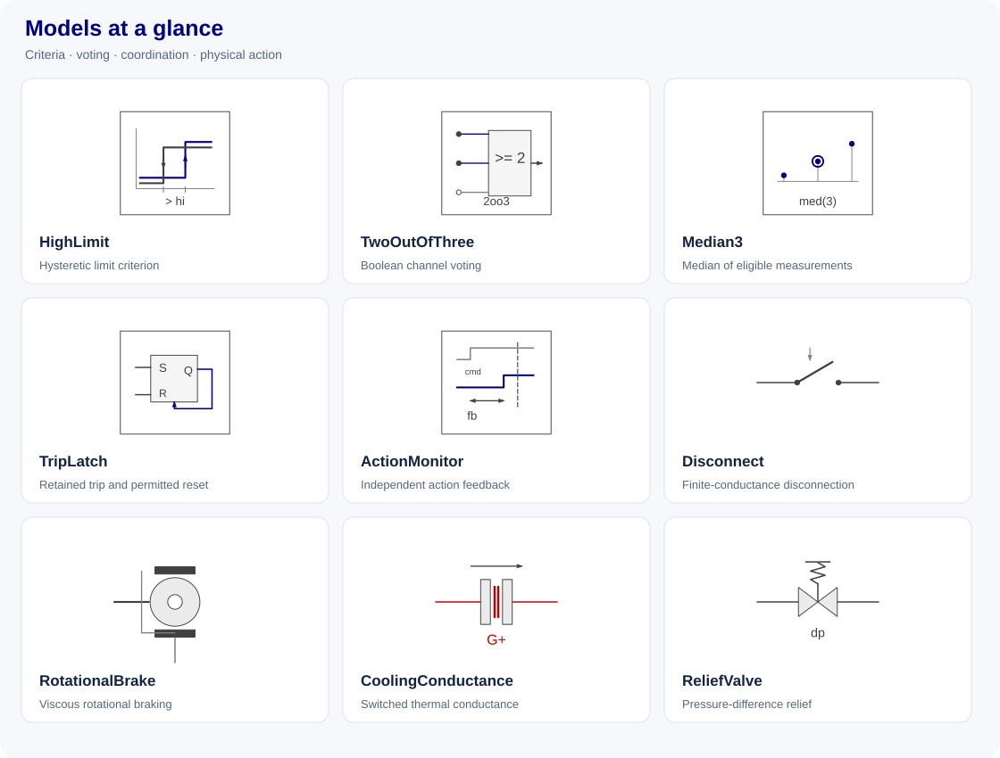

# ProtectionLibrary v1.0.0 — User Guide

English · [简体中文](UserGuide.zh-CN.md)

## Contents

- [1. Scope and package structure](#1-scope-and-package-structure)
- [2. Load the library and inspect the first example](#2-load-the-library-and-inspect-the-first-example)
- [3. Build a criterion, dwell and reset chain](#3-build-a-criterion-dwell-and-reset-chain)
- [4. Configure Boolean and analogue voting](#4-configure-boolean-and-analogue-voting)
- [5. Select command coordination and recovery rules](#5-select-command-coordination-and-recovery-rules)
- [6. Connect a physical protective action](#6-connect-a-physical-protective-action)
- [7. Confirm action with independent feedback](#7-confirm-action-with-independent-feedback)
- [8. Adapt a protection chain to a model](#8-adapt-a-protection-chain-to-a-model)
- [9. Complete model and class reference](#9-complete-model-and-class-reference)
- [10. Included examples](#10-included-examples)
- [11. Troubleshooting and known modelling limits](#11-troubleshooting-and-known-modelling-limits)
- [12. Documentation and further reading](#12-documentation-and-further-reading)

## 1. Scope and package structure

ProtectionLibrary provides criteria, channel voting, command coordination and physical protective devices for Modelica simulations. It contains **71 public protection components** and **9 complete examples**, with **113 Modelica source files** in total. Its only library dependency is **Modelica Standard Library 4.0.0**.

A typical application connects measured quantities to a criterion, combines or retains the resulting request, applies an action to the model and observes the response. These roles have distinct interfaces: a Boolean request is a decision signal, a physical device imposes network equations, and an action monitor interprets independently supplied feedback.

| Package | Components | Contents |
| --- | --- | --- |
| [`Criteria`](../Criteria/package.mo) | 12 | Thresholds, validity, persistence, sequence checks and accumulated exposure. |
| [`Voting`](../Voting/package.mo) | 16 | Fixed and configurable Boolean votes and analogue fusion. |
| [`Coordination`](../Coordination/package.mo) | 18 | Latches, reset permission, interlocks, overrides, priorities and action monitoring. |
| [`Electrical`](../Electrical/package.mo) | 7 | Electrical signal limiting, disconnection, discharge and source transfer. |
| [`Mechanics`](../Mechanics/package.mo) | 8 | Motion criteria, signal limits, viscous brakes and a travel stop. |
| [`Thermal`](../Thermal/package.mo) | 6 | Temperature criteria, derating and physical heat-transfer paths. |
| [`Fluid`](../Fluid/package.mo) | 4 | Isolation, bypass, pressure relief and flow-command limiting. |

`Utilities` contains three functions, seven enumerations and three internal example-pattern blocks. `UsersGuide` supplies concise guidance inside the modelling tool. The complete reference in section 9 covers every source file, including package and helper definitions.



These previews use the existing local Modelica `Icon` graphics with instance and parameter labels omitted. The model icons, diagrams and connector positions are retained.

## 2. Load the library and inspect the first example

1. Extract the archive and retain the complete `ProtectionLibrary` directory.
2. Load Modelica 4.0.0, then open `ProtectionLibrary/package.mo` in the modelling environment.
3. Open `ProtectionLibrary.Examples.ThresholdLatchReset` and inspect its Diagram view.
4. Use the stored experiment: 0–6 s, output interval 0.01 s and tolerance `1e-6`.
5. Plot `signal.y`, `limit.request`, `persist.request`, `safeDwell.resetAllowed`, `reset.y` and `protectedState` together.

The example combines a high threshold of 10, a reset threshold of 8, a 0.2 s request dwell and a 0.25 s clear dwell. Its initial high input sets the latch at 0.2 s. The reset pulse at 1.2 s occurs during the second high interval and is rejected. The pulse at 3.4 s clears the latch after the input has remained low for long enough.

For OpenModelica, run these commands from the directory containing the `ProtectionLibrary` folder:

```modelica
loadModel(Modelica, {"4.0.0"});
loadFile("ProtectionLibrary/package.mo");
checkModel(ProtectionLibrary.Examples.ThresholdLatchReset);
simulate(ProtectionLibrary.Examples.ThresholdLatchReset,
  startTime=0, stopTime=6, numberOfIntervals=600,
  tolerance=1e-6);
getErrorString();
```

Next, change one criterion or dwell parameter in a copy of the example and compare the corresponding signals. Keep the original example available as the connection reference. The intervals and numerical values in this guide are derived from the source equations and parameters.

## 3. Build a criterion, dwell and reset chain

`HighLimit` retains its condition between the trip and reset levels. `Persistence` requires its input to remain true for `holdTime`. `TripLatch` retains a qualified trip until a new reset edge arrives while `resetAllowed` is true and trip is false.

Save this complete model as `FirstTripChain.mo`, load it after the library and run its stored experiment:

```modelica
within;
model FirstTripChain "Qualify a high signal and permit a later reset"
  Modelica.Blocks.Sources.RealExpression signal(
    y=if time >= 1 and time < 2 then 12 else 7);
  Modelica.Blocks.Sources.BooleanExpression reset(
    y=(time >= 2.1 and time < 2.15) or
      (time >= 2.4 and time < 2.5));
  Modelica.Blocks.Sources.BooleanExpression permissive(y=true);
  ProtectionLibrary.Criteria.HighLimit limit(
    tripLevel=10, resetLevel=8);
  ProtectionLibrary.Criteria.Persistence persist(holdTime=0.2);
  ProtectionLibrary.Coordination.ResetPermission clearDwell(
    clearTime=0.25);
  ProtectionLibrary.Coordination.TripLatch latch;
equation
  connect(signal.y, limit.u);
  connect(limit.request, persist.u);
  connect(limit.request, clearDwell.danger);
  connect(permissive.y, clearDwell.permissives);
  connect(persist.request, latch.trip);
  connect(reset.y, latch.reset);
  connect(clearDwell.resetAllowed, latch.resetAllowed);
  annotation(experiment(StartTime=0, StopTime=3,
    Interval=0.005, Tolerance=1e-6));
end FirstTripChain;
```

Plot `signal.y`, `persist.request`, `clearDwell.resetAllowed`, `reset.y` and `latch.latched`.

| Event | Expected behaviour |
| --- | --- |
| Input rises at 1 s | The high-limit request becomes true; the persistence timer starts. |
| Dwell completes at 1.2 s | `persist.request` and `latch.latched` become true. |
| Input falls at 2 s | The criterion and persistence requests clear; the latch remains set. |
| Reset rises at 2.1 s | The clear dwell is incomplete, so the reset is rejected. |
| Clear dwell completes at 2.25 s | Reset permission becomes true; the latch still needs a new reset edge. |
| Reset rises at 2.4 s | The permitted edge clears the latch. |

Holding reset high while permission later becomes true does not clear `TripLatch`. Trip also wins when trip and reset are true together. Select the reset signal and permissives deliberately instead of assuming that a low measured value automatically resets a retained trip.

Many criteria expose `useValidInput`, `inputValid`, `condition` and `request`. Enable and connect the conditional validity input when the application supplies qualification. Read all three outputs together: invalid data can select `failSafe` independently of the measured condition. High-limit, low-limit and outside-band hysteresis continues to follow the measurement even when external qualification is false.

For `SignalValidity`, a range, age or qualification failure makes `request=failSafe`. Choosing `failSafe=false` therefore suppresses the request for those failures too; inspect its diagnostics when a separate validity decision is needed. `RateOfChange` uses sampled history and trusted-sample flags, so its sample interval and rate convention form part of the criterion definition.

## 4. Configure Boolean and analogue voting

Boolean voters count true votes against a fixed or configurable threshold. Each invalid channel contributes the configured `invalidVote`; the default is true. `minValid` controls `enoughValid` as a separate diagnostic and does not gate the vote output `y`.

Analogue voters discard invalid or non-finite entries. Their `available` output indicates whether the selected fusion has enough eligible data; when unavailable, the public block applies its configured fallback. A median with an even eligible count averages the middle pair.

This complete example compares the two Boolean invalid-channel policies and an analogue median using the same qualification pattern:

```modelica
within;
model FirstQualifiedVoting "Compare validity policies and analogue availability"
  Modelica.Blocks.Sources.BooleanExpression votes[3](
    y={true,false,true});
  Modelica.Blocks.Sources.BooleanExpression qualified[3](
    y={time < 2,time < 1,false});
  Modelica.Blocks.Sources.RealExpression measurements[3](
    y={10,11,100});
  ProtectionLibrary.Voting.BooleanVoting.TwoOutOfThree voteTrue(
    useValidInput=true, invalidVote=true, minValid=2);
  ProtectionLibrary.Voting.BooleanVoting.TwoOutOfThree voteFalse(
    useValidInput=true, invalidVote=false, minValid=2);
  ProtectionLibrary.Voting.AnalogVoting.Median3 fused(
    useValidInput=true,
    minValid=2,
    fallback=ProtectionLibrary.Utilities.Types.Fallback.Value,
    fallbackValue=-1);
equation
  connect(votes.y, voteTrue.u);
  connect(votes.y, voteFalse.u);
  connect(qualified.y, voteTrue.valid);
  connect(qualified.y, voteFalse.valid);
  connect(measurements.y, fused.u);
  connect(qualified.y, fused.valid);
  annotation(experiment(StartTime=0, StopTime=3,
    Interval=0.01, Tolerance=1e-6));
end FirstQualifiedVoting;
```

Plot `voteTrue.y`, `voteFalse.y`, `voteTrue.enoughValid`, `fused.y`, `fused.available` and `fused.nValid`.

| Interval | Eligible channels | `voteTrue.y` | `voteFalse.y` | `enoughValid` | `fused.y` | `fused.available` |
| --- | --- | --- | --- | --- | --- | --- |
| 0 ≤ time < 1 s | 1 and 2 | true | false | true | 10.5 | true |
| 1 ≤ time < 2 s | 1 | true | false | false | -1 | false |
| 2 ≤ time ≤ 3 s | None | true | false | false | -1 | false |

The value 100 is never eligible in this example. A value is not automatically rejected merely because it differs from the other measurements: supply a validity decision or use an appropriate disagreement criterion when the application requires one.

| Selection | Configuration detail |
| --- | --- |
| Fixed Boolean votes | Choose the named structure and set `minValid`, `useValidInput` and `invalidVote`. |
| `MOutOfN` | Set both channel count `n` and threshold `m`; check the validity policy separately. |
| Median and mean | Choose the fixed channel count or `AnalogSelector`; configure minimum eligibility and fallback. |
| `TrimmedMean` | Remove `trimEachSide` entries from each end; at least `minValid` entries must remain afterwards. |
| `WeightedMean` | Use nonnegative channel weights and a positive total weight among eligible entries. Zero-weight eligible entries still count in `nValid`. |
| `Fallback.HoldLast` | Initialises from `fallbackValue`; on loss of availability it retains the fusion of the pre-event inputs and qualification flags. |

`nValid` is counted before trimming. `Utilities.Functions.Fuse` reports zero with `available=false` when fusion is unavailable; the public analogue blocks provide the fallback policy around that function. Internal helpers have different contracts and are not interchangeable with the public voters.

## 5. Select command coordination and recovery rules

Choose a coordination block by its event and recovery semantics. A true Boolean command takes its physical meaning from the connected action.

| Component | Behaviour to configure |
| --- | --- |
| `PrioritySelector` | Selects emergency, protection, degraded and normal values in that priority order; inspect `selectedSource` alongside the value. |
| `StartInterlock` | Combines the start request, all permissives and the trip condition. |
| `ResetPermission` and `TripLatch` | Separately qualify a clear interval and retain a trip until a permitted reset edge. |
| `OnOffDelay` | Applies separate delays to acquisition and removal of the input condition. |
| `MinimumHold` | Holds its output for the configured interval; emergency forces that output true. |
| `MinimumOffTime` | Starts `holdOff` at the trip rising edge. A long trip may exhaust the interval before it clears. |
| `RealOverride` | Applies the protective value immediately; `recoveryRate=0` restores the normal command immediately, while a positive value limits recovery. |
| `ProtectiveRamp` | Limits both transition directions after initialisation and approaches the target with first-order dynamics near the endpoint. |
| `DegradedMode` | Uses explicit availability and restoration rules; `restoreAllowed` qualifies return to Normal, while Safe-to-Degraded recovery has a separate condition. |

Use `CommandPriorityAndInterlock` to inspect command authority and a separate delayed start-permission path. Use the complete reference for selectors, load allocation, loss-of-link fallback and other coordination blocks. A delay, a minimum hold and a latch provide different memory; they should be selected by the required transition rule.

## 6. Connect a physical protective action

Signal limits change a command value. Physical components connect to electrical pins, mechanical flanges, heat ports or fluid ports and contribute equations to that network.

| Domain | Physical starting points | Signal starting points |
| --- | --- | --- |
| Electrical | `Disconnect`, `DumpLoad`, `VoltageClamp`, `SourceTransfer` | `CurrentLimiter`, `VoltageGuard`, `PowerDerating` |
| Mechanics | `RotationalBrake`, `TranslationalBrake`, `TravelStop` | `ForceLimiter`, `TorqueLimiter`, `ControlledStop`, `TravelGuard` |
| Thermal | `CoolingConductance`, `ThermalIsolation`, `CoolingEnable` | `HeatInputLimiter`, `OverTemperatureGuard`, `TemperatureDerating` |
| Fluid | `IsolationValve`, `BypassValve`, `ReliefValve` | `FlowLimiter` |

This complete thermal model connects a switched conductance between a heated body and an ambient boundary:

```modelica
within;
model FirstProtectiveCooling "Switch a physical heat-transfer path on temperature"
  Modelica.Thermal.HeatTransfer.Sources.FixedHeatFlow heat(Q_flow=100);
  Modelica.Thermal.HeatTransfer.Components.HeatCapacitor body(
    C=100, T(start=300, fixed=true));
  Modelica.Thermal.HeatTransfer.Sources.FixedTemperature ambient(T=300);
  ProtectionLibrary.Thermal.CoolingConductance cooling(Goff=1, Gon=10);
  Modelica.Blocks.Sources.RealExpression sensor(y=body.T);
  ProtectionLibrary.Criteria.HighLimit hot(tripLevel=316, resetLevel=307);
equation
  connect(heat.port, body.port);
  connect(body.port, cooling.port_a);
  connect(cooling.port_b, ambient.port);
  connect(sensor.y, hot.u);
  connect(hot.request, cooling.command);
  annotation(experiment(StartTime=0, StopTime=60,
    Interval=0.01, Tolerance=1e-6));
end FirstProtectiveCooling;
```

Plot `body.T`, `hot.request`, `cooling.conductance` and `cooling.heatFlow`. Before activation, the body approaches 400 K with a 100 s time constant. It reaches the 316 K threshold at approximately 17.44 s. With conductance 10 W/K, the equilibrium becomes 310 K and the time constant becomes 10 s. The 307 K reset level is below that equilibrium, so cooling remains enabled in this configuration. These values follow directly from the heat balance.

Read the local physical assumptions before connecting a device:

- `Disconnect` retains its configured off-state conductance `Goff`, which may be zero. `SourceTransfer` uses zero off-state conductance. Both use positive on-state resistance; keep the circuit well posed when every transfer path is open. Provide a discharge path for stored inductive energy where the model requires one. `VoltageClamp` uses a finite conductance beyond its threshold rather than imposing an exact voltage bound.
- Viscous brake effort depends on velocity and is capped by `tauMax` or `Fmax`; the brakes provide no holding force or torque at rest. `TravelStop` is a compliant contact model.
- Thermal conductances transport heat between explicit nodes and store no energy. Increasing conductance can transfer heat in either direction depending on the temperature difference.
- Fluid valve `openingTime` is a first-order time constant, not a full-stroke completion time. Use a consistent medium, connect both ports and preserve the required pressure reference. `ReliefValve` uses signed differential pressure and permits reverse flow through its conductance.
- `SourceTransfer` starts with both paths open and applies its break interval at initialisation and each selection edge.

The known binding limitation of `Mechanics.OverspeedGuard` is described in section 11. For a sustained overspeed criterion, feed an explicit speed-magnitude comparison into `Criteria.Persistence.u`.

## 7. Confirm action with independent feedback

`ActionMonitor.command` is the requested action. `measuredAction` must describe an observed actuator or process response. Connecting the command back as its own feedback makes the acknowledgement immediate without checking the action.

Open `Examples.ActionFeedbackAndFailure` and use its 0–4 s experiment. Plot `goodActuator.y`, `refusedActuator.y` and the `acknowledged`, `failed`, `late` and `failureCount` values from both monitors. Both paths receive the same command at 1 s; one actuator receives its requested input, while the other is held at zero.

The responsive actuator has a 0.05 s time constant and reaches its 0.9 feedback threshold about 0.115 s after the command, within the 0.2 s deadline. The refused path reaches the deadline at 1.2 s without feedback and increments its failure count once.

`ActionMonitor` records the first action for each command. An acknowledged action remains acknowledged if feedback later disappears; it is not continuous confirmation monitoring. Results remain until the next command, while `unexpectedAction` is retained across commands without a reset input. `SequenceGuard` checks current confirmation after its deadline and can request again when confirmation disappears. Choose the monitor that matches the intended meaning of successful action.

## 8. Adapt a protection chain to a model

1. Identify the measured quantity, unit and qualification source. Set thresholds and hysteresis using that same scale.
2. Decide how invalid data affects the request. Read validity and availability diagnostics alongside the decision output.
3. Select any voting, dwell, priority, latch or recovery rule. Document simultaneous-request precedence and initial conditions.
4. Connect a signal command or physical device appropriate to the receiving interface. Keep energy storage, dissipation and boundary conditions explicit.
5. Define independent feedback and an acceptable response interval where action confirmation is needed.
6. Plot the measured cause, request, selected command and physical response together. Compare a parameter change against the same input and initial state.

A component example demonstrates its stated configuration. It does not exercise every combination of validity loss, simultaneous events, zero delays, recovery and physical loading. Review the relevant source contract and use the complete examples as connection references when adapting a model.

## 9. Complete model and class reference

The tables cover all 113 source files, grouped by package. Each link opens the corresponding Modelica definition. Read the configuration and limits alongside the parameter dialogue when selecting a criterion, voter, coordinator or physical device.

### 9.1. ProtectionLibrary

| Class | Purpose | Configuration and limits |
| --- | --- | --- |
| [`ProtectionLibrary`](../package.mo) | Criteria, voting, coordination and physical protection components | Load package.mo with Modelica 4.0.0 and begin with Examples.ThresholdLatchReset. |

### 9.2. Criteria

| Class | Purpose | Configuration and limits |
| --- | --- | --- |
| [`Criteria`](../Criteria/package.mo) | Signal, timing and sequence protection criteria | Choose the criterion by its signal type, qualification rule and invalid-input behaviour. |
| [`HighLimit`](../Criteria/HighLimit.mo) | Upper-limit criterion with hysteretic reset | Set the trip and lower reset levels; connect u and, if enabled, valid. Inspect condition, inputValid and request together. Invalid input selects failSafe without freezing the hysteresis state. |
| [`LowLimit`](../Criteria/LowLimit.mo) | Lower-limit criterion with hysteretic reset | Set the trip and higher reset levels; connect u and, if enabled, valid. Inspect condition, inputValid and request together. Invalid input selects failSafe without freezing the hysteresis state. |
| [`OperatingWindow`](../Criteria/OperatingWindow.mo) | Mode-qualified request with an independent emergency path | Connect localRequest, enabled, mode and emergency; set modeId to the applicable operating mode. |
| [`OutsideBand`](../Criteria/OutsideBand.mo) | Independent lower and upper hysteresis criteria | Set the two trip limits and inner reset limits; inspect below and above to distinguish the causes. |
| [`Persistence`](../Criteria/Persistence.mo) | Continuous dwell qualification of a Boolean condition | Connect the Boolean cause to u, set holdTime and choose the invalid-input policy separately. This is sustained qualification, not an event pulse or a latch. |
| [`RateOfChange`](../Criteria/RateOfChange.mo) | Sampled finite-difference rate criterion | Choose samplePeriod, sampleStart, threshold and sense; inspect rate and available before using request. Availability tracks consecutive validity flags, not the finiteness of stored samples. |
| [`SensorDisagreement`](../Criteria/SensorDisagreement.mo) | Spread criterion over valid finite sensor channels | Connect n comparable measurements, choose tolerance and optionally supply channel validity flags. Disagreement detects inconsistency; it does not identify the faulty channel. |
| [`SequenceGuard`](../Criteria/SequenceGuard.mo) | Deadline check for sustained action feedback | Connect commandActive and a measured completion condition to confirmed, then set deadline. This checks current confirmation after the deadline; it does not retain a successful acknowledgement. |
| [`SequencePermissive`](../Criteria/SequencePermissive.mo) | Armed sequence with a timed proof requirement | Connect arm, prerequisite and a proof event; set proofDeadline and route permit to the next command stage. A held proof level cannot provide a new proof after permission has been cleared. |
| [`SignalValidity`](../Criteria/SignalValidity.mo) | Range and age qualification with an invalid-data policy | Connect the value and its age, set inclusive limits and choose failSafe; inspect the cause outputs alongside request. The block uses the supplied age; it does not infer freshness from changes in u. |
| [`Watchdog`](../Criteria/Watchdog.mo) | Timeout since a count increase or heartbeat edge | Select useCount, connect the corresponding input and set timeout and graceTime. Count resets and held heartbeat levels do not constitute new activity. |
| [`WindowEnergyTrip`](../Criteria/WindowEnergyTrip.mo) | Positive-energy criterion over a moving time window | Connect measured power in watts, set the positive window length and energyLimit in joules. Only positive power is accumulated; returned energy does not cancel earlier consumption. |

### 9.3. Voting

| Class | Purpose | Configuration and limits |
| --- | --- | --- |
| [`Voting`](../Voting/package.mo) | Boolean voting and analogue measurement fusion | Use BooleanVoting for requests and AnalogVoting for measurements. |

### 9.4. Voting.AnalogVoting

| Class | Purpose | Configuration and limits |
| --- | --- | --- |
| [`AnalogVoting`](../Voting/AnalogVoting/package.mo) | Qualified analogue fusion with explicit fallback | Choose the fusion statistic, minimum eligible count and fallback policy. |
| [`AnalogSelector`](../Voting/AnalogVoting/AnalogSelector.mo) | Configurable fusion of qualified analogue measurements | Set n, method, minValid and the fallback policy; provide weights or trimEachSide for the selected method. Weighted fusion requires positive eligible weight; trimmed fusion requires minValid values after trimming. |
| [`Mean3`](../Voting/AnalogVoting/Mean3.mo) | Arithmetic mean of qualified measurements from three channels | Connect three same-unit measurements; set minValid and the fallback policy. Every eligible value contributes equally; weights and trimEachSide do not change the mean. |
| [`Mean5`](../Voting/AnalogVoting/Mean5.mo) | Arithmetic mean of qualified measurements from five channels | Connect five same-unit measurements; set minValid and the fallback policy. Every eligible value contributes equally; weights and trimEachSide do not change the mean. |
| [`Median3`](../Voting/AnalogVoting/Median3.mo) | Median of qualified measurements from three channels | Connect three same-unit measurements; set minValid and the fallback policy. With two eligible channels, the result is their mean; the block does not apply a disagreement threshold. |
| [`Median5`](../Voting/AnalogVoting/Median5.mo) | Median of qualified measurements from five channels | Connect five same-unit measurements; set minValid and the fallback policy. An even eligible count averages the middle pair; the block does not apply a disagreement threshold. |
| [`TrimmedMean`](../Voting/AnalogVoting/TrimmedMean.mo) | Mean after trimming qualified measurements at both ends | Set n, trimEachSide, minValid and the fallback policy; allow enough eligible channels after trimming. nValid reports the count before trimming; availability uses nValid-2*trimEachSide. |
| [`WeightedMean`](../Voting/AnalogVoting/WeightedMean.mo) | Normalised weighted mean of qualified measurements | Set nonnegative weights, minValid and the fallback policy; connect n same-unit measurements. Zero-weight eligible channels count towards minValid; a zero eligible weight sum still makes the result unavailable. |

### 9.5. Voting.BooleanVoting

| Class | Purpose | Configuration and limits |
| --- | --- | --- |
| [`BooleanVoting`](../Voting/BooleanVoting/package.mo) | Boolean thresholds with explicit invalid-channel votes | Choose a fixed pattern or MOutOfN; configure invalidVote deliberately. |
| [`MOutOfN`](../Voting/BooleanVoting/MOutOfN.mo) | Configurable Boolean vote with invalid-channel substitution | Set n and m, choose invalidVote and minValid, and connect valid when useValidInput=true. enoughValid is diagnostic only; the default invalidVote=true can assert y when every channel is invalid. |
| [`OneOutOfThree`](../Voting/BooleanVoting/OneOutOfThree.mo) | Boolean 1-out-of-3 vote with invalid-channel substitution | Connect 3 Boolean requests; choose invalidVote and minValid, and enable valid inputs when qualification is required. enoughValid is diagnostic only; the default invalidVote=true can assert y when every channel is invalid. |
| [`OneOutOfTwo`](../Voting/BooleanVoting/OneOutOfTwo.mo) | Boolean 1-out-of-2 vote with invalid-channel substitution | Connect 2 Boolean requests; choose invalidVote and minValid, and enable valid inputs when qualification is required. enoughValid is diagnostic only; the default invalidVote=true can assert y when every channel is invalid. |
| [`ThreeOutOfFive`](../Voting/BooleanVoting/ThreeOutOfFive.mo) | Boolean 3-out-of-5 vote with invalid-channel substitution | Connect 5 Boolean requests; choose invalidVote and minValid, and enable valid inputs when qualification is required. enoughValid is diagnostic only; the default invalidVote=true can assert y when every channel is invalid. |
| [`ThreeOutOfThree`](../Voting/BooleanVoting/ThreeOutOfThree.mo) | Boolean 3-out-of-3 vote with invalid-channel substitution | Connect 3 Boolean requests; choose invalidVote and minValid, and enable valid inputs when qualification is required. enoughValid is diagnostic only; the default invalidVote=true can assert y when every channel is invalid. |
| [`TwoOutOfFive`](../Voting/BooleanVoting/TwoOutOfFive.mo) | Boolean 2-out-of-5 vote with invalid-channel substitution | Connect 5 Boolean requests; choose invalidVote and minValid, and enable valid inputs when qualification is required. enoughValid is diagnostic only; the default invalidVote=true can assert y when every channel is invalid. |
| [`TwoOutOfFour`](../Voting/BooleanVoting/TwoOutOfFour.mo) | Boolean 2-out-of-4 vote with invalid-channel substitution | Connect 4 Boolean requests; choose invalidVote and minValid, and enable valid inputs when qualification is required. enoughValid is diagnostic only; the default invalidVote=true can assert y when every channel is invalid. |
| [`TwoOutOfThree`](../Voting/BooleanVoting/TwoOutOfThree.mo) | Boolean 2-out-of-3 vote with invalid-channel substitution | Connect 3 Boolean requests; choose invalidVote and minValid, and enable valid inputs when qualification is required. enoughValid is diagnostic only; the default invalidVote=true can assert y when every channel is invalid. |
| [`TwoOutOfTwo`](../Voting/BooleanVoting/TwoOutOfTwo.mo) | Boolean 2-out-of-2 vote with invalid-channel substitution | Connect 2 Boolean requests; choose invalidVote and minValid, and enable valid inputs when qualification is required. enoughValid is diagnostic only; the default invalidVote=true can assert y when every channel is invalid. |

### 9.6. Coordination

| Class | Purpose | Configuration and limits |
| --- | --- | --- |
| [`Coordination`](../Coordination/package.mo) | Protection request coordination and command handling | Select the required retention, timing, arbitration and recovery behaviour before connecting commands. |
| [`ActionMonitor`](../Coordination/ActionMonitor.mo) | Acknowledgement and timeout of commanded actions | Connect command and measuredAction, set timeout and inspect acknowledged, failed, late, timestamps and failureCount. The first acknowledgement is retained; this is not continuous verification of the final actuator state. |
| [`BooleanOverride`](../Coordination/BooleanOverride.mo) | Boolean command override during protection | Connect the nominal command to u, the protective request to protect and set safeValue. |
| [`DegradedMode`](../Coordination/DegradedMode.mo) | Capability-based degraded and safe-state selection | Supply fullCapability, minimumCapability, protect and restoreAllowed; use state or its integer mode output. Capability is supplied by the application; the block does not assess it from plant measurements. |
| [`ExclusiveEnable`](../Coordination/ExclusiveEnable.mo) | Conflict suppression for mutually exclusive requests | Connect requested and permitted arrays of length n; use enabled and monitor conflict. |
| [`LossOfLinkFallback`](../Coordination/LossOfLinkFallback.mo) | Fallback selection with separate loss and recovery dwells | Connect linkHealthy and u; set lossDwell and recoveryDwell in seconds and fallback in the same unit as u. Link health is an external input; the block contains no heartbeat detector. |
| [`MinimumHold`](../Coordination/MinimumHold.mo) | Minimum on and off dwell with immediate emergency enable | Connect u and emergency, then choose the minimum on and off durations for the controlled command. Emergency forces true; it does not inherently mean a physical shutdown. |
| [`MinimumOffTime`](../Coordination/MinimumOffTime.mo) | Restart inhibition measured from each trip edge | Connect trip and runDemand; set holdOff and use runCommand as the permitted demand. This does not guarantee a further off interval after trip clears. |
| [`ModeFallback`](../Coordination/ModeFallback.mo) | Operating-mode override with safe-state priority | Bind normalMode to OperatingMode and connect degrade and stop requests. |
| [`OnOffDelay`](../Coordination/OnOffDelay.mo) | Separate continuous delays for rising and falling commands | Connect u and set onDelay and offDelay for the required input qualification. |
| [`PriorityLoadAllocation`](../Coordination/PriorityLoadAllocation.mo) | Sequential power allocation in channel-priority order | Order demand by descending priority, connect the available budget in watts and use allocated as load commands. |
| [`PrioritySelector`](../Coordination/PrioritySelector.mo) | Fixed-priority selection of real commands | Connect all four values and the three overriding requests; inspect selectedSource alongside y. |
| [`ProtectiveRamp`](../Coordination/ProtectiveRamp.mo) | Rate-limited tracking of protective and normal commands | Set safeCommand, maxRate and responseTime, then connect u and request. The rate constraint applies to the command trajectory, not measured actuator motion. |
| [`RealOverride`](../Coordination/RealOverride.mo) | Immediate real override with optional controlled recovery | Connect u and protect, set safeValue and choose immediate or rate-limited recovery. Protection acts immediately; recovery limiting is not a permanent rate limit on u. |
| [`RedundantChannelSelect`](../Coordination/RedundantChannelSelect.mo) | Availability-based primary and backup command selection | Connect both commands and their validity flags; set fallback and inspect valid with usingBackup. |
| [`ResetPermission`](../Coordination/ResetPermission.mo) | Reset permission after a continuous clear interval | Connect danger and the combined permissives, then route resetAllowed to the reset gate of a latch. |
| [`SafeStateSelector`](../Coordination/SafeStateSelector.mo) | Priority selection of integer state commands | Set the three mode codes and connect protect and emergency to obtain modeRequest. |
| [`StartInterlock`](../Coordination/StartInterlock.mo) | Start request gated by all permissives and trip clearance | Connect n permissives, startRequest and trip; use startPermitted and the two refusal diagnostics. |
| [`TripLatch`](../Coordination/TripLatch.mo) | Trip-priority latch with a qualified reset edge | Connect trip, an explicit reset request and resetAllowed; use latched for retained protection. |

### 9.7. Electrical

| Class | Purpose | Configuration and limits |
| --- | --- | --- |
| [`Electrical`](../Electrical/package.mo) | Electrical criteria, commands and dissipative devices | Choose signal or electrical-pin interfaces, then configure the thresholds, limits or passive path parameters. |
| [`CurrentLimiter`](../Electrical/CurrentLimiter.mo) | Symmetric saturation of a current command | Set the nonnegative Imax and connect u and y in amperes; inspect limited for command saturation. The bound applies to the command; circuit current depends on the receiving device. |
| [`Disconnect`](../Electrical/Disconnect.mo) | Commanded electrical contact with residual conductance | Place p and n in the circuit path, set Ron and Goff, and drive openCommand; connect heatPort when enabled. No contact motion, arc or actuation delay is represented; isOpen follows the selected constitutive relation. |
| [`DumpLoad`](../Electrical/DumpLoad.mo) | Switched resistive load with off-state conductance | Connect p and n across the load path, choose R and Goff, and drive command; enable heatPort to export losses. The off-state leakage is set independently by Goff; resistance does not depend on temperature. |
| [`PowerDerating`](../Electrical/PowerDerating.mo) | Power-command scaling with symmetric rated limits | Set ratedPower and factor, connect the signed power request and derate input, then use y as the power command. limited covers both derating and saturation; it does not measure delivered power. |
| [`SourceTransfer`](../Electrical/SourceTransfer.mo) | Break-before-make transfer between two electrical feeds | Connect both feeds and the load, set deadTime and contactResistance, and drive selectBackup; inspect both closed-state outputs. Both feeds are disconnected initially and during each transfer; the load circuit must support that interval. |
| [`VoltageClamp`](../Electrical/VoltageClamp.mo) | Symmetric dissipative shunt above a voltage threshold | Connect p and n across the bus, set Vmax and G, and inspect voltage, current and lossPower; connect an enabled heatPort. Finite conductance permits voltage above the threshold and contains no thermal storage. |
| [`VoltageGuard`](../Electrical/VoltageGuard.mo) | Independent hysteretic under- and overvoltage requests | Order lowTrip &lt; lowClear &lt;= highClear &lt; highTrip; connect voltage and use request or the individual threshold flags. The block evaluates its supplied signal directly; it does not calculate RMS voltage. |

### 9.8. Mechanics

| Class | Purpose | Configuration and limits |
| --- | --- | --- |
| [`Mechanics`](../Mechanics/package.mo) | Mechanical criteria, command limits and contact devices | Choose command processing or physical flange connections, then check the sign convention and stated device limits. |
| [`ControlledStop`](../Mechanics/ControlledStop.mo) | Signed speed-command ramp towards rest | Insert the block in the speed-command path, supply measuredSpeed for capture and set positive deceleration. The drive must track the generated command; the block applies no mechanical braking torque. |
| [`ForceLimiter`](../Mechanics/ForceLimiter.mo) | Saturation of a signed force command | Set lower &lt;= upper, connect the force request to u and use y as the limited command. The receiving actuator or source determines the actual physical response. |
| [`OverspeedGuard`](../Mechanics/OverspeedGuard.mo) | Overspeed request wrapper with persistence settings | For the intended dwell chain, feed abs(speed)&gt;limit to Criteria.Persistence.u with holdTime=dwell. The supplied wrapper assigns persistence.condition and leaves persistence.u unbound; its internal binding needs correction before use. |
| [`RotationalBrake`](../Mechanics/RotationalBrake.mo) | Saturated viscous brake for relative angular motion | Connect flange, set tauMax and d, and drive command; connect support when useSupport=true. Braking is viscous and vanishes at rest; command changes apply immediately. |
| [`TorqueLimiter`](../Mechanics/TorqueLimiter.mo) | Saturation of a signed torque command | Set lower &lt;= upper, connect the torque request to u and use y as the limited command. The receiving actuator or source determines the actual physical response. |
| [`TranslationalBrake`](../Mechanics/TranslationalBrake.mo) | Saturated viscous brake for relative translation | Connect flange, set Fmax and d, and drive command; connect support when useSupport=true. Braking is viscous and vanishes at rest; command changes apply immediately. |
| [`TravelGuard`](../Mechanics/TravelGuard.mo) | Directional speed reduction near travel bounds | Set minimumPosition, maximumPosition and buffer; connect position and requestedSpeed, then use speedCommand. Speed-command attenuation alone does not prevent a moving body from crossing a travel bound. |
| [`TravelStop`](../Mechanics/TravelStop.mo) | Compliant travel stops with compression-only damping | Connect both flanges, set lower and upper, and choose k, d and positive blend; use twoSided to enable the lower stop. Contact compliance permits travel beyond the nominal bounds; lossPower excludes elastic energy storage. |

### 9.9. Thermal

| Class | Purpose | Configuration and limits |
| --- | --- | --- |
| [`Thermal`](../Thermal/package.mo) | Thermal criteria, command derating and heat-flow devices | Choose a signal or heat-port interface and define the receiving thermal network explicitly. |
| [`CoolingConductance`](../Thermal/CoolingConductance.mo) | Commanded increase of a thermal conductance | Connect both heat ports, set Goff and Gon, and drive command; inspect conductance and signed heatFlow. Heat follows the temperature difference; the element does not prescribe a cooling power or cold temperature. |
| [`CoolingEnable`](../Thermal/CoolingEnable.mo) | Temperature-dependent extraction of bounded heat flow | Connect port to the thermal node, order coolingStart below coolingFull, set maxCooling and drive request. The imposed cooling load has no represented electrical supply, coolant inventory or heat-rejection circuit. |
| [`HeatInputLimiter`](../Thermal/HeatInputLimiter.mo) | Saturation of a heat-flow command | Set lower &lt;= upper, connect the heat-flow request to u and use y as the limited command. The receiving actuator or source determines the actual physical response. |
| [`OverTemperatureGuard`](../Thermal/OverTemperatureGuard.mo) | Hysteretic temperature limit with an armed rate criterion | Set the temperature thresholds and sampling parameters; connect temperature and use request, fastRise and rate. The rate estimate needs two samples; sampled detection does not capture every intersample transient. |
| [`TemperatureDerating`](../Thermal/TemperatureDerating.mo) | Linear temperature-dependent command derating | Set Tstart &lt; Tstop and minFactor in [0,1], connect T and u, then read y and factor. The factor scales signed commands without imposing an absolute output limit. |
| [`ThermalIsolation`](../Thermal/ThermalIsolation.mo) | Commanded reduction to a residual thermal conductance | Connect both heat ports, set Gnominal and GResidual, and drive command to select the residual path. Thermal isolation is partial whenever GResidual is positive. |

### 9.10. Fluid

| Class | Purpose | Configuration and limits |
| --- | --- | --- |
| [`Fluid`](../Fluid/package.mo) | Fluid command limits and linear protective flow paths | Use FlowLimiter for commands; choose a valve for a physical fluid path and redeclare a compatible medium. |
| [`BypassValve`](../Fluid/BypassValve.mo) | Commanded opening of a linear fluid bypass | Choose Medium, connect both fluid ports, set conductances and actuator parameters, and drive command to open the path. Flow is reversible and linear in pressure difference; openingTime specifies a time constant and leakage may remain. |
| [`FlowLimiter`](../Fluid/FlowLimiter.mo) | Saturation of a signed mass-flow command | Set lower &lt;= upper, connect the mass-flow request to u and use y as the limited command. The receiving actuator or source determines the actual physical response. |
| [`IsolationValve`](../Fluid/IsolationValve.mo) | Commanded closure of a linear fluid path | Choose Medium, connect both fluid ports, set conductances and actuator parameters, and drive command to close the path. Flow is reversible and linear in pressure difference; openingTime specifies a time constant and leakage may remain. |
| [`ReliefValve`](../Fluid/ReliefValve.mo) | Hysteretic pressure-relief request with a dynamic opening | Choose Medium, connect both ports, order openPressure above closePressure, and inspect reliefRequest, opening and massFlow. The trigger uses signed pressure difference, not absolute inlet pressure; leakage and reverse flow are possible. |

### 9.11. Utilities

| Class | Purpose | Configuration and limits |
| --- | --- | --- |
| [`Utilities`](../Utilities/package.mo) | Supporting functions, enumerations and example inputs | Use public component interfaces first; consult the supporting function contracts when calling helpers directly. |

### 9.12. Utilities.Functions

| Class | Purpose | Configuration and limits |
| --- | --- | --- |
| [`Functions`](../Utilities/Functions/package.mo) | Qualified measurement fusion functions | Call Fuse when an equation or algorithm needs the same fusion calculation as the analogue voters. |
| [`Fuse`](../Utilities/Functions/Fuse.mo) | Fuse finite qualified measurements and report availability | Call Fuse(u, valid, weights, minValid, trimEachSide, method) and read value, nValid and available. Use minValid&gt;=1 and nonnegative trimming; availability is separate from a legitimate zero result. |

### 9.13. Utilities.Internal

| Class | Purpose | Configuration and limits |
| --- | --- | --- |
| [`Internal`](../Utilities/Internal/package.mo) | Low-level helpers and prescribed example signals | Use the fixed patterns in examples and check helper preconditions before direct calls. |
| [`AnalogPattern`](../Utilities/Internal/AnalogPattern.mo) | Fixed analogue values with declining qualification | Connect u3/valid3 or u5/valid5 to analogue voters in an example. |
| [`PriorityPattern`](../Utilities/Internal/PriorityPattern.mo) | Prescribed command levels, requests and permissions | Connect command values and request flags to a selector; connect start and permissions to an interlock. |
| [`VotePattern`](../Utilities/Internal/VotePattern.mo) | Fixed Boolean vote and qualification schedule | Connect the required leading entries of votes and valid to each fixed voting pattern. |
| [`countVotes`](../Utilities/Internal/countVotes.mo) | Count qualified channels and their true requests | Call countVotes(channel, valid) when separate qualified-channel and true-request counts are needed. Unlike public Boolean voters, invalid channels are ignored rather than replaced by invalidVote. |
| [`fusedValue`](../Utilities/Internal/fusedValue.mo) | Fuse a vector without qualification or fallback | Call fusedValue(x, method, trimEachSide, weights) only after validating the complete vector and selected method settings. Uses FusionMethod, a distinct enumeration from the AnalogMethod type accepted by Fuse. |

### 9.14. Utilities.Types

| Class | Purpose | Configuration and limits |
| --- | --- | --- |
| [`Types`](../Utilities/Types/package.mo) | Protection selections and declared state types | Use the exact enumeration type declared by the receiving component. |
| [`AnalogMethod`](../Utilities/Types/AnalogMethod.mo) | Qualified analogue fusion methods | Set method using AnalogMethod values on the public analogue fusion interfaces. |
| [`Authority`](../Utilities/Types/Authority.mo) | Named sources of control authority | Use Authority where the interface declares a command-source label. |
| [`DegradedState`](../Utilities/Types/DegradedState.mo) | Declared capability states | Read DegradedState with the transition rules of DegradedMode. |
| [`Fallback`](../Utilities/Types/Fallback.mo) | Output policy for unavailable analogue fusion | Select Value or HoldLast and configure fallbackValue in the analogue voter. |
| [`FusionMethod`](../Utilities/Types/FusionMethod.mo) | Algorithms for complete-vector fusion | Use FusionMethod with Internal.fusedValue; keep it distinct from AnalogMethod. |
| [`OperatingMode`](../Utilities/Types/OperatingMode.mo) | Requested operating modes for protection arbitration | Use OperatingMode values with a declared mode interface such as ModeFallback. |
| [`RateSense`](../Utilities/Types/RateSense.mo) | Direction selected for a sampled rate criterion | Select Absolute, Rising or Falling for RateOfChange.sense. |

### 9.15. UsersGuide

| Class | Purpose | Configuration and limits |
| --- | --- | --- |
| [`UsersGuide`](../UsersGuide/package.mo) | User's guide | Start with GettingStarted, then review Conventions and Limitations. |
| [`Conventions`](../UsersGuide/Conventions.mo) | Signal validity, command priority and physical interfaces | Check validity policy, reset edges, priority, units and the selected physical interface before connection. |
| [`GettingStarted`](../UsersGuide/GettingStarted.mo) | Load the library and inspect a threshold-to-reset chain | Run ThresholdLatchReset, inspect each stage, then compare the two actuator paths in ActionFeedbackAndFailure. |
| [`Limitations`](../UsersGuide/Limitations.mo) | Component assumptions and known interface limitations | Check physical assumptions, independent feedback and the documented OverspeedGuard binding limitation. |
| [`Overview`](../UsersGuide/Overview.mo) | Protection components and package organisation | Choose components by the measured quantity, decision interface and required physical action. |

### 9.16. Examples

| Class | Purpose | Configuration and limits |
| --- | --- | --- |
| [`Examples`](../Examples/package.mo) | Connected examples of criteria, voting and physical protection | Run ThresholdLatchReset first, then choose a voting, coordination, feedback or physical-domain example. |
| [`ActionFeedbackAndFailure`](../Examples/ActionFeedbackAndFailure.mo) | Compare requested action with independent actuator feedback | Run the stored experiment; see section 10. |
| [`AnalogVoting`](../Examples/AnalogVoting.mo) | Compare median and mean under changing channel validity | Run the stored experiment; see section 10. |
| [`BooleanVoting`](../Examples/BooleanVoting.mo) | Compare fixed Boolean votes and invalid-channel policies | Run the stored experiment; see section 10. |
| [`CommandPriorityAndInterlock`](../Examples/CommandPriorityAndInterlock.mo) | Combine command authority with a delayed start interlock | Run the stored experiment; see section 10. |
| [`ElectricalTripAndDump`](../Examples/ElectricalTripAndDump.mo) | Open supply paths and provide an inductive discharge branch | Run the stored experiment; see section 10. |
| [`FluidIsolationAndRelief`](../Examples/FluidIsolationAndRelief.mo) | Combine inlet isolation with a separate vessel relief branch | Run the stored experiment; see section 10. |
| [`MechanicalBraking`](../Examples/MechanicalBraking.mo) | Apply finite viscous braking to rotational and translational bodies | Run the stored experiment; see section 10. |
| [`ThermalCooling`](../Examples/ThermalCooling.mo) | Compare switched thermal conductance with a fixed cooling path | Run the stored experiment; see section 10. |
| [`ThresholdLatchReset`](../Examples/ThresholdLatchReset.mo) | Combine hysteresis, persistence and a permitted reset edge | Run the stored experiment; see section 10. |

## 10. Included examples

Each example contains its sources, connections and stored experiment settings. All use tolerance `1e-6`; their output intervals are listed below. Select the interface relevant to the application and begin with the listed outputs.

| Example | Simulation interval; output interval | What to inspect |
| --- | --- | --- |
| [`ActionFeedbackAndFailure`](../Examples/ActionFeedbackAndFailure.mo) | 0–4 s; 0.008 s | Compare goodActuator.y and refusedActuator.y with the two monitors; distinguish acknowledgement from timeout and failureCount. |
| [`AnalogVoting`](../Examples/AnalogVoting.mo) | 0–4 s; 0.008 s | Plot median3Value, mean3Value, median5Value and mean5Value with the corresponding available and nValid signals. |
| [`BooleanVoting`](../Examples/BooleanVoting.mo) | 0–4 s; 0.008 s | Compare twoOutOfThreeRequest and mOutOfNRequest during invalid-channel intervals, alongside nValid and enoughValid. |
| [`CommandPriorityAndInterlock`](../Examples/CommandPriorityAndInterlock.mo) | 0–6 s; 0.01 s | Compare selectedCommand and selectCommand.selectedSource, then compare the immediate interlock output with startAllowed. |
| [`ElectricalTripAndDump`](../Examples/ElectricalTripAndDump.mo) | 0–5 s; 0.01 s | Inspect the supply-path currents, coil.i and dump.lossPower before and after the 1 s trip. |
| [`FluidIsolationAndRelief`](../Examples/FluidIsolationAndRelief.mo) | 0–10 s; 0.01 s | Compare protectedVolume.medium.p and referenceVolume.medium.p; inspect relief flow and inlet isolation at 8 s. |
| [`MechanicalBraking`](../Examples/MechanicalBraking.mo) | 0–5 s; 0.01 s | Plot rotationBody.w and translationBody.v with brakeRequest.y and inspect the finite braking response. |
| [`ThermalCooling`](../Examples/ThermalCooling.mo) | 0–60 s; 0.01 s | Compare protectedBody.T, referenceBody.T and protectedCooling.heatFlow; inspect the separate limitCommand.y signal. |
| [`ThresholdLatchReset`](../Examples/ThresholdLatchReset.mo) | 0–6 s; 0.01 s | Compare the criterion, qualified request, reset permission and protectedState; the permitted reset is at 3.4 s. |

## 11. Troubleshooting and known modelling limits

| Observation | Check |
| --- | --- |
| A request is true while the measured limit is clear | Inspect `inputValid` and `failSafe`; invalid data can select a protective request. |
| A Boolean vote stays true with too few valid channels | `invalidVote` substitutes each invalid vote; `enoughValid` does not gate `y`. |
| An analogue result changes to its fallback | Check qualification, finite values, minimum remaining entries after trimming and eligible weight. |
| A trip does not clear after permission returns | Supply a new reset edge with trip false; a held reset is insufficient. |
| A minimum-off interval seems shorter than expected | `MinimumOffTime.holdOff` is measured from the trip rising edge. |
| Action is acknowledged immediately | Check for already-true feedback and ensure feedback is independent of the command. |
| A brake does not hold the body at rest | The brake is viscous; it has no static locking relation. |
| A fluid valve does not reach its target at `openingTime` | That parameter is the time constant of a first-order opening state. |
| A signal limiter does not alter the physical system | Connect its output to a receiving source or control input; it has no physical port. |

### Known interface limitation: OverspeedGuard

The current `Mechanics.OverspeedGuard` assigns its speed comparison to `persistence.condition`, which `Criteria.Persistence` declares and computes as an output. The required input `persistence.u` is left unbound. This is a source-level interface inconsistency in that wrapper, and it must be reviewed before the wrapper is used.

For the intended criterion chain, create a Boolean expression `abs(speed) > limit`, connect that expression's output to `Criteria.Persistence.u`, set `holdTime=dwell` and use the persistence request downstream. This manual does not treat the existing wrapper as a verified implementation of that chain. Its equations and parameter defaults are retained in this release.

Other component limits remain local to their implementation. A finite soft clamp, an ideal signal saturation, a sampled rate criterion and a physical energy-dissipation path describe different relations. The source reference states the configuration and notable limits for each class. Analytical values in this guide follow from the equations; compare them with results in the Modelica environment used for the application.

## 12. Documentation and further reading

- [English project overview](../README.md) / [中文项目说明](../README.zh-CN.md)
- [In-tool User's Guide](../UsersGuide/package.mo)
- [Root package](../package.mo)
- [Buildings Library User Guide — Getting Started](https://simulationresearch.lbl.gov/modelica/userGuide/gettingStarted.html)
- [Buildings — SimpleHouse step-by-step tutorial](https://simulationresearch.lbl.gov/modelica/releases/v11.1.2/help/Buildings_Examples_Tutorial_SimpleHouse.html)
- [Modelica documentation conventions](https://doc.modelica.org/Modelica%204.0.0/Resources/helpDymola/Modelica_UsersGuide_Conventions_Documentation.html)
- [Licence: GNU General Public License v3](../LICENSE)
