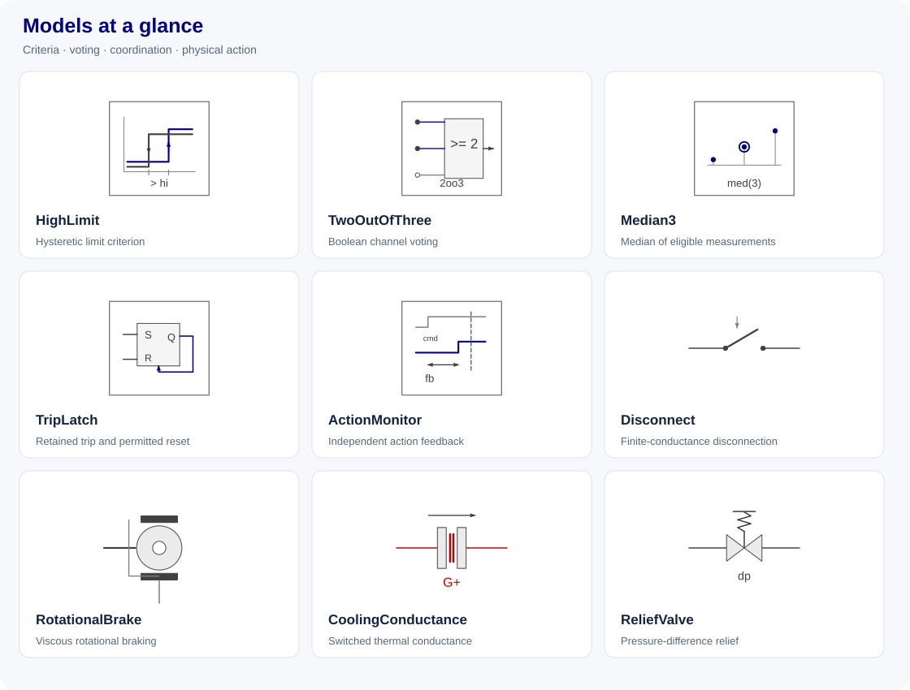

# ProtectionLibrary v1.0.0 — 使用手册

[English](UserGuide.md) · 简体中文

## 目录

- [1. 适用范围与包结构](#1-适用范围与包结构)
- [2. 加载库并查看第一个示例](#2-加载库并查看第一个示例)
- [3. 建立判据、持续条件与复位链路](#3-建立判据持续条件与复位链路)
- [4. 配置布尔表决与模拟量融合](#4-配置布尔表决与模拟量融合)
- [5. 选择命令协调与恢复规则](#5-选择命令协调与恢复规则)
- [6. 连接物理保护动作](#6-连接物理保护动作)
- [7. 通过独立反馈确认动作](#7-通过独立反馈确认动作)
- [8. 将保护链路用于模型](#8-将保护链路用于模型)
- [9. 完整模型与类参考](#9-完整模型与类参考)
- [10. 自带示例](#10-自带示例)
- [11. 问题排查与已知建模边界](#11-问题排查与已知建模边界)
- [12. 文档与延伸阅读](#12-文档与延伸阅读)

## 1. 适用范围与包结构

ProtectionLibrary 为 Modelica 仿真提供保护判据、通道表决、命令协调及物理保护元件。库中包含 **71 个公开保护组件**、**9 个完整示例**，共 **113 个 Modelica 源码文件**。唯一的库依赖是 **Modelica Standard Library 4.0.0**。

典型应用将测量量接入判据，对产生的请求进行组合或保持，再向模型施加动作并观察响应。这些环节具有不同的接口：布尔请求是决策信号，物理元件向网络引入方程，动作监视器则根据独立提供的反馈判断动作情况。

| 包 | 组件数量 | 内容 |
| --- | --- | --- |
| [`Criteria`](../Criteria/package.mo) | 12 | 阈值、有效性、持续条件、顺序检查及累计暴露量。 |
| [`Voting`](../Voting/package.mo) | 16 | 固定及可配置布尔表决与模拟量融合。 |
| [`Coordination`](../Coordination/package.mo) | 18 | 锁存、复位许可、联锁、覆盖、优先级及动作监视。 |
| [`Electrical`](../Electrical/package.mo) | 7 | 电气信号限制、断开、耗能及电源切换。 |
| [`Mechanics`](../Mechanics/package.mo) | 8 | 运动判据、信号限制、黏性制动及行程限位。 |
| [`Thermal`](../Thermal/package.mo) | 6 | 温度判据、降额及物理传热路径。 |
| [`Fluid`](../Fluid/package.mo) | 4 | 隔离、旁通、泄压及流量命令限制。 |

`Utilities` 包含三个函数、七个枚举类型和三个用于内部示例的信号模式模块。`UsersGuide` 在建模工具中提供简明说明。第 9 节的完整参考覆盖全部源码文件，包括包与辅助定义。



图标预览直接采用模型现有的 Modelica `Icon` 图形，并省略实例名与参数标签。模型原有图标、图形布局及连接器位置均予以保留。

## 2. 加载库并查看第一个示例

1. 解压压缩包，保留完整的 `ProtectionLibrary` 目录。
2. 在建模环境中加载 Modelica 4.0.0，然后打开 `ProtectionLibrary/package.mo`。
3. 打开 `ProtectionLibrary.Examples.ThresholdLatchReset`，查看其 Diagram 视图。
4. 使用自带实验设置：仿真区间 0–6 s，输出间隔 0.01 s，容差 `1e-6`。
5. 一起绘制 `signal.y`、`limit.request`、`persist.request`、`safeDwell.resetAllowed`、`reset.y` 和 `protectedState`。

该示例采用上限阈值 10、复位阈值 8、0.2 s 的请求持续时间及 0.25 s 的危险解除持续时间。初始高输入使锁存在 0.2 s 时置位。1.2 s 时的复位脉冲处于第二段高输入区间内，因此被拒绝。输入持续保持低值足够长时间后，3.4 s 时的脉冲清除锁存。

在 OpenModelica 中，可从包含 `ProtectionLibrary` 文件夹的目录运行以下命令：

```modelica
loadModel(Modelica, {"4.0.0"});
loadFile("ProtectionLibrary/package.mo");
checkModel(ProtectionLibrary.Examples.ThresholdLatchReset);
simulate(ProtectionLibrary.Examples.ThresholdLatchReset,
  startTime=0, stopTime=6, numberOfIntervals=600,
  tolerance=1e-6);
getErrorString();
```

随后可复制示例，每次修改一个判据参数或持续时间参数，对比相应信号。保留原示例作为连接参考。本手册中的区间与数值均依据源码方程和参数推导。

## 3. 建立判据、持续条件与复位链路

`HighLimit` 在触发阈值与复位阈值之间保持已有判定状态。`Persistence` 要求输入连续为 true 达到 `holdTime`。`TripLatch` 保持经过持续条件确认的触发，直到 trip 为 false、`resetAllowed` 为 true 时收到新的复位上升沿。

将以下完整模型保存为 `FirstTripChain.mo`，在加载库后打开，并使用其自带实验设置运行：

```modelica
within;
model FirstTripChain "Qualify a high signal and permit a later reset"
  Modelica.Blocks.Sources.RealExpression signal(
    y=if time >= 1 and time < 2 then 12 else 7);
  Modelica.Blocks.Sources.BooleanExpression reset(
    y=(time >= 2.1 and time < 2.15) or
      (time >= 2.4 and time < 2.5));
  Modelica.Blocks.Sources.BooleanExpression permissive(y=true);
  ProtectionLibrary.Criteria.HighLimit limit(
    tripLevel=10, resetLevel=8);
  ProtectionLibrary.Criteria.Persistence persist(holdTime=0.2);
  ProtectionLibrary.Coordination.ResetPermission clearDwell(
    clearTime=0.25);
  ProtectionLibrary.Coordination.TripLatch latch;
equation
  connect(signal.y, limit.u);
  connect(limit.request, persist.u);
  connect(limit.request, clearDwell.danger);
  connect(permissive.y, clearDwell.permissives);
  connect(persist.request, latch.trip);
  connect(reset.y, latch.reset);
  connect(clearDwell.resetAllowed, latch.resetAllowed);
  annotation(experiment(StartTime=0, StopTime=3,
    Interval=0.005, Tolerance=1e-6));
end FirstTripChain;
```

绘制 `signal.y`、`persist.request`、`clearDwell.resetAllowed`、`reset.y` 和 `latch.latched`。

| 事件 | 预期行为 |
| --- | --- |
| 输入在 1 s 时升高 | 上限请求变为 true，持续条件计时开始。 |
| 持续条件在 1.2 s 时满足 | `persist.request` 和 `latch.latched` 变为 true。 |
| 输入在 2 s 时降低 | 判据请求与持续条件请求清除，锁存仍保持置位。 |
| 复位信号在 2.1 s 时上升 | 危险解除持续时间尚未满足，复位被拒绝。 |
| 危险解除持续时间在 2.25 s 时满足 | 复位许可变为 true，但锁存仍需等待新的复位上升沿。 |
| 复位信号在 2.4 s 时上升 | 获得许可的上升沿清除锁存。 |

若复位信号一直为 true，即使许可随后变为 true，也不会清除 `TripLatch`。trip 与 reset 同时为 true 时，trip 优先。因此应明确设计复位信号及许可条件，不能将测量值降低等同于自动解除锁存。

许多判据提供 `useValidInput`、`inputValid`、`condition` 和 `request`。应用需要外部有效性判定时，应启用并连接条件有效性输入。应同时观察三个输出：输入无效时，`failSafe` 可独立于测量条件决定请求。上限、下限和区间外判据的滞回状态即使在外部有效性为 false 时，仍会跟随测量值变化。

对于 `SignalValidity`，数值范围、信号年龄或资格判定不满足要求时，均有 `request=failSafe`。因此设置 `failSafe=false` 也会抑制这些无效情况下的请求；需要独立的有效性结论时，应检查其诊断输出。`RateOfChange` 使用采样历史与可信采样标志，其采样间隔及变化率方向约定都是判据定义的一部分。

## 4. 配置布尔表决与模拟量融合

布尔表决模块将 true 票数与固定或可配置阈值比较。每个无效通道均贡献由 `invalidVote` 指定的替代票，默认值为 true。`minValid` 仅控制独立诊断量 `enoughValid`，不会门控表决输出 `y`。

模拟量表决模块剔除无效或非有限数值。`available` 表示所选融合方法是否具备足够的有效数据；结果不可用时，公开模块采用配置的回退策略。有效值数量为偶数时，中位数取中间两值的平均。

以下完整示例使用相同的通道资格模式，对比两种布尔无效通道策略与模拟量中位数：

```modelica
within;
model FirstQualifiedVoting "Compare validity policies and analogue availability"
  Modelica.Blocks.Sources.BooleanExpression votes[3](
    y={true,false,true});
  Modelica.Blocks.Sources.BooleanExpression qualified[3](
    y={time < 2,time < 1,false});
  Modelica.Blocks.Sources.RealExpression measurements[3](
    y={10,11,100});
  ProtectionLibrary.Voting.BooleanVoting.TwoOutOfThree voteTrue(
    useValidInput=true, invalidVote=true, minValid=2);
  ProtectionLibrary.Voting.BooleanVoting.TwoOutOfThree voteFalse(
    useValidInput=true, invalidVote=false, minValid=2);
  ProtectionLibrary.Voting.AnalogVoting.Median3 fused(
    useValidInput=true,
    minValid=2,
    fallback=ProtectionLibrary.Utilities.Types.Fallback.Value,
    fallbackValue=-1);
equation
  connect(votes.y, voteTrue.u);
  connect(votes.y, voteFalse.u);
  connect(qualified.y, voteTrue.valid);
  connect(qualified.y, voteFalse.valid);
  connect(measurements.y, fused.u);
  connect(qualified.y, fused.valid);
  annotation(experiment(StartTime=0, StopTime=3,
    Interval=0.01, Tolerance=1e-6));
end FirstQualifiedVoting;
```

绘制 `voteTrue.y`、`voteFalse.y`、`voteTrue.enoughValid`、`fused.y`、`fused.available` 和 `fused.nValid`。

| 区间 | 有效通道 | `voteTrue.y` | `voteFalse.y` | `enoughValid` | `fused.y` | `fused.available` |
| --- | --- | --- | --- | --- | --- | --- |
| 0 ≤ time < 1 s | 1 和 2 | true | false | true | 10.5 | true |
| 1 ≤ time < 2 s | 1 | true | false | false | -1 | false |
| 2 ≤ time ≤ 3 s | 无 | true | false | false | -1 | false |

本例中的数值 100 始终不具备参与融合的资格。测量值不会仅因与其他测量值不同而被自动剔除；应用需要此类判定时，应提供相应的有效性结论，或采用合适的测量不一致判据。

| 选项 | 配置要点 |
| --- | --- |
| 固定布尔表决 | 选择对应结构，并设置 `minValid`、`useValidInput` 和 `invalidVote`。 |
| `MOutOfN` | 同时设置通道数 `n` 与阈值 `m`，另行检查有效性策略。 |
| 中位数与算术平均 | 选择固定通道数的模块或 `AnalogSelector`，配置最少有效数量与回退策略。 |
| `TrimmedMean` | 在排序后两端分别去除 `trimEachSide` 个值，剩余数量须不小于 `minValid`。 |
| `WeightedMean` | 使用非负通道权重，且有效通道的权重总和须为正。权重为零的有效通道仍计入 `nValid`。 |
| `Fallback.HoldLast` | 以 `fallbackValue` 初始化；可用性丧失时，保存按事件前输入及资格标志计算的融合结果。 |

`nValid` 表示截尾前的数量。`Utilities.Functions.Fuse` 在结果不可用时返回零，并令 `available=false`；公开模拟量模块在该函数外实现回退策略。内部辅助函数具有不同的接口约定，不能与公开表决模块直接互换。

## 5. 选择命令协调与恢复规则

应根据事件处理及恢复语义选择协调模块。布尔命令为 true 时的具体物理含义，取决于所连接的动作。

| 组件 | 应配置的行为 |
| --- | --- |
| `PrioritySelector` | 按紧急、保护、降级、正常的优先顺序选择命令值；同时观察 `selectedSource` 与输出值。 |
| `StartInterlock` | 组合启动请求、全部许可条件及触发条件。 |
| `ResetPermission` 与 `TripLatch` | 分别确认危险解除持续区间，并将触发保持至获得许可的新复位上升沿。 |
| `OnOffDelay` | 对条件建立与解除分别施加延时。 |
| `MinimumHold` | 按配置的区间保持输出；emergency 会将输出强制置为 true。 |
| `MinimumOffTime` | 从 trip 上升沿开始计算 `holdOff`；trip 持续较长时，该区间可能在触发解除前就已耗尽。 |
| `RealOverride` | 立即采用保护值；`recoveryRate=0` 时立即恢复正常命令，取正值时限制恢复速度。 |
| `ProtectiveRamp` | 初始化后限制两个方向的过渡速度，并在目标附近以一阶动态逼近目标。 |
| `DegradedMode` | 使用明确的可用能力及恢复规则；`restoreAllowed` 约束返回 Normal，而 Safe 到 Degraded 的恢复具有独立条件。 |

使用 `CommandPriorityAndInterlock` 查看命令来源与独立的延时启动许可链路。其他选择器、负载分配、失联回退和协调组件见完整参考。延时、最短保持与锁存具有不同的记忆行为，应按所需转移规则选用。

## 6. 连接物理保护动作

信号限制模块改变命令值。物理元件则通过电气引脚、机械法兰、热端口或流体端口连接，并向对应网络引入方程。

| 领域 | 可先选用的物理元件 | 可先选用的信号组件 |
| --- | --- | --- |
| 电气 | `Disconnect`、`DumpLoad`、`VoltageClamp`、`SourceTransfer` | `CurrentLimiter`、`VoltageGuard`、`PowerDerating` |
| 机械 | `RotationalBrake`、`TranslationalBrake`、`TravelStop` | `ForceLimiter`、`TorqueLimiter`、`ControlledStop`、`TravelGuard` |
| 热 | `CoolingConductance`、`ThermalIsolation`、`CoolingEnable` | `HeatInputLimiter`、`OverTemperatureGuard`、`TemperatureDerating` |
| 流体 | `IsolationValve`、`BypassValve`、`ReliefValve` | `FlowLimiter` |

以下完整热模型在受热物体与环境边界之间连接一条可切换热导的传热路径：

```modelica
within;
model FirstProtectiveCooling "Switch a physical heat-transfer path on temperature"
  Modelica.Thermal.HeatTransfer.Sources.FixedHeatFlow heat(Q_flow=100);
  Modelica.Thermal.HeatTransfer.Components.HeatCapacitor body(
    C=100, T(start=300, fixed=true));
  Modelica.Thermal.HeatTransfer.Sources.FixedTemperature ambient(T=300);
  ProtectionLibrary.Thermal.CoolingConductance cooling(Goff=1, Gon=10);
  Modelica.Blocks.Sources.RealExpression sensor(y=body.T);
  ProtectionLibrary.Criteria.HighLimit hot(tripLevel=316, resetLevel=307);
equation
  connect(heat.port, body.port);
  connect(body.port, cooling.port_a);
  connect(cooling.port_b, ambient.port);
  connect(sensor.y, hot.u);
  connect(hot.request, cooling.command);
  annotation(experiment(StartTime=0, StopTime=60,
    Interval=0.01, Tolerance=1e-6));
end FirstProtectiveCooling;
```

绘制 `body.T`、`hot.request`、`cooling.conductance` 和 `cooling.heatFlow`。动作触发前，物体以 100 s 的时间常数趋近 400 K，约在 17.44 s 时达到 316 K 阈值。热导切换到 10 W/K 后，平衡温度变为 310 K，时间常数变为 10 s。307 K 的复位阈值低于该平衡温度，因此本配置下冷却保持启用。上述结果可直接由热平衡方程推导。

连接元件前，应检查其局部物理假设：

- `Disconnect` 保留配置的关断电导 `Goff`，该值可以为零；`SourceTransfer` 的关断电导为零。两者的导通电阻均为正，所有切换路径断开时仍须保证电路方程适定。模型需要时，应为储存的电感能量提供耗散路径。`VoltageClamp` 在超过阈值后采用有限电导，而非强制施加精确电压上限。
- 黏性制动力或转矩随速度变化，并受 `tauMax` 或 `Fmax` 限幅；在静止时不提供保持力或保持转矩。`TravelStop` 是柔性接触模型。
- 热导元件在明确连接的节点间传热，本身不储能。增大热导后，热量仍可能随温差方向向任一侧传递。
- 流体阀的 `openingTime` 是一阶时间常数，不是完成全行程的时间。应使用一致的介质、连接两个端口，并保持必要的压力参考。`ReliefValve` 使用有符号压差，允许通过其流导关系产生反向流动。
- `SourceTransfer` 在初始化时两条路径均断开，并在初始化及每次选择信号跳变时施加断开间隔。

`Mechanics.OverspeedGuard` 的已知绑定问题见第 11 节。需要超速持续时间判据时，可将明确的速度绝对值比较结果接入 `Criteria.Persistence.u`。

## 7. 通过独立反馈确认动作

`ActionMonitor.command` 表示所请求的动作。`measuredAction` 应反映观测到的执行器或过程响应。将命令本身回接为反馈，会立即得到确认，却没有检查实际动作。

打开 `Examples.ActionFeedbackAndFailure`，使用其 0–4 s 实验设置。绘制 `goodActuator.y`、`refusedActuator.y`，以及两个监视器的 `acknowledged`、`failed`、`late` 和 `failureCount`。两条路径在 1 s 时收到相同命令；一条执行器路径接受所请求的输入，另一条输入始终被置为零。

正常响应的执行器时间常数为 0.05 s，约在命令后 0.115 s 达到 0.9 的反馈阈值，处于 0.2 s 的期限内。拒动路径在 1.2 s 达到期限仍无反馈，其失败计数增加一次。

`ActionMonitor` 为每次命令记录首次动作。动作被确认后，即使反馈消失，确认状态仍保持，因此它不提供持续确认监视。结果保持至下一次命令；`unexpectedAction` 则跨命令保持，且没有复位输入。`SequenceGuard` 在期限后检查当前确认状态，确认消失时可以再次产生请求。应根据预期的动作成功含义选择监视器。

## 8. 将保护链路用于模型

1. 明确测量量、单位及有效性来源。采用相同量纲与尺度设置阈值和滞回。
2. 决定无效数据如何影响请求。将有效性、可用性诊断与决策输出一起读取。
3. 选择所需的表决、持续条件、优先级、锁存或恢复规则，明确同时请求的优先次序与初始条件。
4. 根据接收接口连接信号命令或物理元件，明确能量存储、耗散及边界条件。
5. 需要确认动作时，定义独立反馈及可接受的响应区间。
6. 同时绘制测量原因、请求、选定命令和物理响应，在相同输入与初始状态下对比参数修改前后的结果。

组件示例演示其给定配置，并未覆盖有效性丧失、同时事件、零延时、恢复及物理负载的全部组合。适配模型时，应检查相应源码约定，并将完整示例作为连接参考。

## 9. 完整模型与类参考

下表按包列出全部 113 个源码文件，点击名称可打开相应 Modelica 定义。选择判据、表决、协调或物理保护组件时，请结合参数对话框阅读配置方法与使用边界。

### 9.1. ProtectionLibrary

| 类 | 用途 | 配置与使用边界 |
| --- | --- | --- |
| [`ProtectionLibrary`](../package.mo) | 判据、表决、协调与物理保护组件。 | 加载 Modelica 4.0.0 和 package.mo，从 Examples.ThresholdLatchReset 入门。 |

### 9.2. Criteria

| 类 | 用途 | 配置与使用边界 |
| --- | --- | --- |
| [`Criteria`](../Criteria/package.mo) | 信号、时序与顺序保护判据。 | 按信号类型、判定规则及输入无效时的行为选择判据。 |
| [`HighLimit`](../Criteria/HighLimit.mo) | 带回差复位的上限判据。 | 设置动作值与较低的复位值，连接 u，并按需启用 valid；结合 condition、inputValid 与 request 观察结果。 输入无效时选择 failSafe，但不会冻结回差状态。 |
| [`LowLimit`](../Criteria/LowLimit.mo) | 带回差复位的下限判据。 | 设置动作值与较高的复位值，连接 u，并按需启用 valid；结合 condition、inputValid 与 request 观察结果。 输入无效时选择 failSafe，但不会冻结回差状态。 |
| [`OperatingWindow`](../Criteria/OperatingWindow.mo) | 带独立紧急通道的模式限定请求。 | 连接 localRequest、enabled、mode 与 emergency，将 modeId 设为适用的运行模式。 |
| [`OutsideBand`](../Criteria/OutsideBand.mo) | 相互独立的上下限回差判据。 | 设置两个动作边界及其内侧复位值，通过 below 与 above 区分触发原因。 |
| [`Persistence`](../Criteria/Persistence.mo) | 对布尔条件进行连续持续时间判定。 | 将布尔原因连接至 u，设置 holdTime，并单独选择输入无效时的策略。 输出是持续的合格标志，并非事件脉冲或锁存状态。 |
| [`RateOfChange`](../Criteria/RateOfChange.mo) | 基于采样有限差分的变化率判据。 | 设置 samplePeriod、sampleStart、threshold 与 sense；使用 request 前同时检查 rate 和 available。 available 反映连续采样的有效标志，不验证历史采样值是否有限。 |
| [`SensorDisagreement`](../Criteria/SensorDisagreement.mo) | 对有效且有限的传感器通道计算极差判据。 | 连接 n 路可比较的测量值，设置 tolerance，并按需提供各通道有效标志。 不一致判据不负责识别哪一路通道故障。 |
| [`SequenceGuard`](../Criteria/SequenceGuard.mo) | 对持续动作反馈进行截止时间检查。 | 连接 commandActive，将实测完成条件接至 confirmed，再设置 deadline。 该模块在截止后检查当前确认状态，不保持曾经成功的确认。 |
| [`SequencePermissive`](../Criteria/SequencePermissive.mo) | 带限时证明要求的布防顺序许可。 | 连接 arm、prerequisite 与证明事件，设置 proofDeadline，将 permit 接至后续命令环节。 许可清除后，持续为真的 proof 电平不能代替新的证明上升沿。 |
| [`SignalValidity`](../Criteria/SignalValidity.mo) | 带无效数据策略的范围与时效判定。 | 连接数值及其数据龄期，设置包含端点的边界并选择 failSafe；结合原因输出读取 request。 模块采用外部提供的 age，不根据 u 是否变化推断数据新鲜度。 |
| [`Watchdog`](../Criteria/Watchdog.mo) | 自计数增加或心跳上升沿起计时的超时判据。 | 通过 useCount 选择并连接对应输入，设置 timeout 与 graceTime。 计数复位与持续心跳高电平不构成新的活动。 |
| [`WindowEnergyTrip`](../Criteria/WindowEnergyTrip.mo) | 滑动时间窗内的正向能量判据。 | 连接以 W 为单位的实测功率，设置正的 windowLength 与以 J 为单位的 energyLimit。 仅累计正向功率，回馈能量不会抵消先前消耗。 |

### 9.3. Voting

| 类 | 用途 | 配置与使用边界 |
| --- | --- | --- |
| [`Voting`](../Voting/package.mo) | 布尔表决与模拟量融合。 | 布尔请求使用 BooleanVoting，测量值融合使用 AnalogVoting。 |

### 9.4. Voting.AnalogVoting

| 类 | 用途 | 配置与使用边界 |
| --- | --- | --- |
| [`AnalogVoting`](../Voting/AnalogVoting/package.mo) | 具有明确回退策略的有效模拟量融合。 | 选择融合统计方法、最少有效数量与回退策略。 |
| [`AnalogSelector`](../Voting/AnalogVoting/AnalogSelector.mo) | 可配置的有效模拟量融合。 | 设置 n、method、minValid 和回退策略；按所选方法提供 weights 或 trimEachSide。 加权融合要求有效权重总和为正；截尾后仍须至少保留 minValid 个值。 |
| [`Mean3`](../Voting/AnalogVoting/Mean3.mo) | 三通道有效模拟量的算术平均。 | 连接三路同单位测量值，设置 minValid 与回退策略。 所有有效值等权参与；weights 与 trimEachSide 不改变算术平均结果。 |
| [`Mean5`](../Voting/AnalogVoting/Mean5.mo) | 五通道有效模拟量的算术平均。 | 连接五路同单位测量值，设置 minValid 与回退策略。 所有有效值等权参与；weights 与 trimEachSide 不改变算术平均结果。 |
| [`Median3`](../Voting/AnalogVoting/Median3.mo) | 三通道有效模拟量的中位数。 | 连接三路同单位测量值，设置 minValid 与回退策略。 仅两路有效时返回两者平均值；模块不执行测量不一致阈值判定。 |
| [`Median5`](../Voting/AnalogVoting/Median5.mo) | 五通道有效模拟量的中位数。 | 连接五路同单位测量值，设置 minValid 与回退策略。 有效值数量为偶数时取中间两值的平均；模块不执行测量不一致阈值判定。 |
| [`TrimmedMean`](../Voting/AnalogVoting/TrimmedMean.mo) | 对有效模拟量两端截尾后求均值。 | 设置 n、trimEachSide、minValid 和回退策略，并确保截尾后仍有足够的有效通道。 nValid 表示截尾前的数量；可用性按 nValid-2*trimEachSide 判定。 |
| [`WeightedMean`](../Voting/AnalogVoting/WeightedMean.mo) | 对有效模拟量求归一化加权平均。 | 设置非负 weights、minValid 与回退策略，连接 n 路同单位测量值。 权重为零的有效通道仍计入 minValid；有效权重总和为零时结果仍不可用。 |

### 9.5. Voting.BooleanVoting

| 类 | 用途 | 配置与使用边界 |
| --- | --- | --- |
| [`BooleanVoting`](../Voting/BooleanVoting/package.mo) | 具有明确无效通道替代票的布尔表决。 | 选择固定表决模式或 MOutOfN，并明确设置 invalidVote。 |
| [`MOutOfN`](../Voting/BooleanVoting/MOutOfN.mo) | 可配置的布尔表决，支持无效通道替代票。 | 设置 n 与 m，选择 invalidVote 和 minValid；useValidInput=true 时连接 valid。 enoughValid 仅供诊断；默认 invalidVote=true 时，即使全部通道无效，y 仍可能为 true。 |
| [`OneOutOfThree`](../Voting/BooleanVoting/OneOutOfThree.mo) | 3 取 1 布尔表决，支持无效通道替代票。 | 连接 3 路布尔请求，选择 invalidVote 和 minValid；需要资格判定时启用 valid 输入。 enoughValid 仅供诊断；默认 invalidVote=true 时，即使全部通道无效，y 仍可能为 true。 |
| [`OneOutOfTwo`](../Voting/BooleanVoting/OneOutOfTwo.mo) | 2 取 1 布尔表决，支持无效通道替代票。 | 连接 2 路布尔请求，选择 invalidVote 和 minValid；需要资格判定时启用 valid 输入。 enoughValid 仅供诊断；默认 invalidVote=true 时，即使全部通道无效，y 仍可能为 true。 |
| [`ThreeOutOfFive`](../Voting/BooleanVoting/ThreeOutOfFive.mo) | 5 取 3 布尔表决，支持无效通道替代票。 | 连接 5 路布尔请求，选择 invalidVote 和 minValid；需要资格判定时启用 valid 输入。 enoughValid 仅供诊断；默认 invalidVote=true 时，即使全部通道无效，y 仍可能为 true。 |
| [`ThreeOutOfThree`](../Voting/BooleanVoting/ThreeOutOfThree.mo) | 3 取 3 布尔表决，支持无效通道替代票。 | 连接 3 路布尔请求，选择 invalidVote 和 minValid；需要资格判定时启用 valid 输入。 enoughValid 仅供诊断；默认 invalidVote=true 时，即使全部通道无效，y 仍可能为 true。 |
| [`TwoOutOfFive`](../Voting/BooleanVoting/TwoOutOfFive.mo) | 5 取 2 布尔表决，支持无效通道替代票。 | 连接 5 路布尔请求，选择 invalidVote 和 minValid；需要资格判定时启用 valid 输入。 enoughValid 仅供诊断；默认 invalidVote=true 时，即使全部通道无效，y 仍可能为 true。 |
| [`TwoOutOfFour`](../Voting/BooleanVoting/TwoOutOfFour.mo) | 4 取 2 布尔表决，支持无效通道替代票。 | 连接 4 路布尔请求，选择 invalidVote 和 minValid；需要资格判定时启用 valid 输入。 enoughValid 仅供诊断；默认 invalidVote=true 时，即使全部通道无效，y 仍可能为 true。 |
| [`TwoOutOfThree`](../Voting/BooleanVoting/TwoOutOfThree.mo) | 3 取 2 布尔表决，支持无效通道替代票。 | 连接 3 路布尔请求，选择 invalidVote 和 minValid；需要资格判定时启用 valid 输入。 enoughValid 仅供诊断；默认 invalidVote=true 时，即使全部通道无效，y 仍可能为 true。 |
| [`TwoOutOfTwo`](../Voting/BooleanVoting/TwoOutOfTwo.mo) | 2 取 2 布尔表决，支持无效通道替代票。 | 连接 2 路布尔请求，选择 invalidVote 和 minValid；需要资格判定时启用 valid 输入。 enoughValid 仅供诊断；默认 invalidVote=true 时，即使全部通道无效，y 仍可能为 true。 |

### 9.6. Coordination

| 类 | 用途 | 配置与使用边界 |
| --- | --- | --- |
| [`Coordination`](../Coordination/package.mo) | 保护请求协调与命令处理。 | 连接命令前，先明确所需的保持、时序、仲裁和恢复行为。 |
| [`ActionMonitor`](../Coordination/ActionMonitor.mo) | 命令动作的确认与超时监测。 | 连接 command 与 measuredAction，设置 timeout，观察 acknowledged、failed、late、时间戳和 failureCount。 首次确认会被保持，不等同于持续验证执行机构的最终状态。 |
| [`BooleanOverride`](../Coordination/BooleanOverride.mo) | 保护期间的布尔命令覆盖。 | 将名义命令接至 u、保护请求接至 protect，并设置 safeValue。 |
| [`DegradedMode`](../Coordination/DegradedMode.mo) | 基于可用能力选择降级与安全状态。 | 提供 fullCapability、minimumCapability、protect 与 restoreAllowed，使用 state 或其整数形式 mode。 能力状态由应用提供，模块不会自行从被控对象测量值中判定。 |
| [`ExclusiveEnable`](../Coordination/ExclusiveEnable.mo) | 互斥请求的冲突抑制。 | 连接长度为 n 的 requested 与 permitted 数组，使用 enabled 并监测 conflict。 |
| [`LossOfLinkFallback`](../Coordination/LossOfLinkFallback.mo) | 分别确认失联与恢复持续时间的备用选择。 | 连接 linkHealthy 和 u；以秒为单位设置 lossDwell、recoveryDwell，并使 fallback 与 u 使用相同单位。 链路健康状态由外部输入，模块内部不含心跳检测器。 |
| [`MinimumHold`](../Coordination/MinimumHold.mo) | 带立即紧急使能的最短通断保持时间。 | 连接 u 与 emergency，为被控制命令设置最短接通和断开时间。 emergency 强制输出 true，其物理含义不一定是停机。 |
| [`MinimumOffTime`](../Coordination/MinimumOffTime.mo) | 自每次跳闸上升沿起计时的重启抑制。 | 连接 trip 与 runDemand，设置 holdOff，通过 runCommand 输出允许的运行需求。 该模块不保证 trip 清除后还要额外保持一段断开时间。 |
| [`ModeFallback`](../Coordination/ModeFallback.mo) | 安全状态优先的运行模式覆盖。 | 将 normalMode 绑定为 OperatingMode，并连接 degrade 与 stop 请求。 |
| [`OnOffDelay`](../Coordination/OnOffDelay.mo) | 分别设置上升与下降连续确认时间。 | 连接 u，按照输入确认要求设置 onDelay 与 offDelay。 |
| [`PriorityLoadAllocation`](../Coordination/PriorityLoadAllocation.mo) | 按通道优先顺序逐项分配功率。 | 按优先级从高到低排列 demand，连接以 W 为单位的可用 budget，将 allocated 用作负载命令。 |
| [`PrioritySelector`](../Coordination/PrioritySelector.mo) | 实数命令的固定优先级选择。 | 连接四路数值与三个覆盖请求，结合 selectedSource 观察 y。 |
| [`ProtectiveRamp`](../Coordination/ProtectiveRamp.mo) | 对保护与正常命令进行斜率受限跟踪。 | 设置 safeCommand、maxRate 与 responseTime，再连接 u 和 request。 斜率约束作用于命令轨迹，不代表实测执行机构运动。 |
| [`RealOverride`](../Coordination/RealOverride.mo) | 立即覆盖实数命令并可限制恢复速率。 | 连接 u 与 protect，设置 safeValue，并选择立即恢复或限速恢复。 保护立即生效，恢复限速并非对 u 始终施加的斜率限制。 |
| [`RedundantChannelSelect`](../Coordination/RedundantChannelSelect.mo) | 依据可用性选择主用与备用命令。 | 连接两路命令及其有效标志，设置 fallback，结合 valid 与 usingBackup 观察选择结果。 |
| [`ResetPermission`](../Coordination/ResetPermission.mo) | 条件连续清除后给出复位许可。 | 连接 danger 与组合 permissives，将 resetAllowed 接至锁存器的复位许可端。 |
| [`SafeStateSelector`](../Coordination/SafeStateSelector.mo) | 按优先级选择整数状态命令。 | 设置三个模式代码，连接 protect 与 emergency，读取 modeRequest。 |
| [`StartInterlock`](../Coordination/StartInterlock.mo) | 由全部许可与跳闸清除条件共同限定启动请求。 | 连接 n 项 permissive、startRequest 与 trip，使用 startPermitted 及两个拒绝原因输出。 |
| [`TripLatch`](../Coordination/TripLatch.mo) | 跳闸优先且要求合格复位上升沿的锁存器。 | 连接 trip、显式 reset 请求和 resetAllowed，通过 latched 保持保护状态。 |

### 9.7. Electrical

| 类 | 用途 | 配置与使用边界 |
| --- | --- | --- |
| [`Electrical`](../Electrical/package.mo) | 电气判据、指令与耗能装置。 | 按信号接口或电气引脚选择组件，再设置门限、限幅或无源路径参数。 |
| [`CurrentLimiter`](../Electrical/CurrentLimiter.mo) | 电流指令的对称限幅。 | 设置非负 Imax，连接以安培计的 u 与 y；通过 limited 判断指令是否被限幅。 限幅作用于指令；电路电流仍取决于接收该指令的设备。 |
| [`Disconnect`](../Electrical/Disconnect.mo) | 具有残余电导的指令控制电气接点。 | 将 p、n 串接到电路路径，设置 Ron、Goff 并输入 openCommand；启用后需连接 heatPort。 不包含触点运动、电弧或动作延迟；isOpen 反映所选本构关系。 |
| [`DumpLoad`](../Electrical/DumpLoad.mo) | 具有关闭状态电导的开关电阻负载。 | 将 p、n 接在所需耗能支路两端，设置 R、Goff 并输入 command；可启用 heatPort 输出损耗热量。 关闭状态漏导由 Goff 独立设置；电阻不随温度变化。 |
| [`PowerDerating`](../Electrical/PowerDerating.mo) | 带对称额定限幅的功率指令缩放。 | 设置 ratedPower、factor，连接带符号功率请求和 derate，将 y 用作功率指令。 limited 同时反映降额与限幅，不表示实际输出功率测量。 |
| [`SourceTransfer`](../Electrical/SourceTransfer.mo) | 两路电源的先断后合切换。 | 连接两路馈线与负载，设置 deadTime 和 contactResistance，输入 selectBackup，并观察两个接点闭合状态。 初始化与每次切换期间两路均断开；负载电路必须能够处理该区间。 |
| [`VoltageClamp`](../Electrical/VoltageClamp.mo) | 超过对称电压门限后的耗能分流支路。 | 将 p、n 并接在母线两端，设置 Vmax、G，观察电压、电流及 lossPower；启用后连接 heatPort。 有限电导允许电压超过门限，模型不包含热储能。 |
| [`VoltageGuard`](../Electrical/VoltageGuard.mo) | 独立迟滞欠压与过压请求。 | 按 lowTrip &lt; lowClear &lt;= highClear &lt; highTrip 设置门限；连接 voltage，使用 request 或独立阈值标志。 模块直接判断输入信号，不计算电压有效值。 |

### 9.8. Mechanics

| 类 | 用途 | 配置与使用边界 |
| --- | --- | --- |
| [`Mechanics`](../Mechanics/package.mo) | 机械判据、指令限制与接触装置。 | 选择指令处理或机械法兰连接方式，并核对符号约定及装置使用边界。 |
| [`ControlledStop`](../Mechanics/ControlledStop.mo) | 向零速收敛的带符号速度指令斜坡。 | 将模块接入速度指令路径，提供用于捕获的 measuredSpeed，并设置正值 deceleration。 驱动需自行跟踪生成的指令；模块本身不施加机械制动力矩。 |
| [`ForceLimiter`](../Mechanics/ForceLimiter.mo) | 带符号力指令限幅。 | 设置 lower &lt;= upper，将 u 与 y 接入以牛顿计的力指令路径。 实际物理响应由接收指令的执行器或源决定。 |
| [`OverspeedGuard`](../Mechanics/OverspeedGuard.mo) | 带持续时间设置的超速请求封装。 | 如需构造预期持续判据链，将 abs(speed)&gt;limit 接入 Criteria.Persistence.u，并设置 holdTime=dwell。 当前封装对 persistence.condition 赋值，却未绑定 persistence.u；使用前需要修正内部绑定。 |
| [`RotationalBrake`](../Mechanics/RotationalBrake.mo) | 相对转动的饱和黏性制动器。 | 连接转动 flange，设置 tauMax 与 d，并输入 command；useSupport=true 时连接 support。 制动为黏性作用，静止时制动力为零；指令变化即时生效。 |
| [`TorqueLimiter`](../Mechanics/TorqueLimiter.mo) | 带符号力矩指令限幅。 | 设置 lower &lt;= upper，将 u 与 y 接入以牛顿米计的力矩指令路径。 实际物理响应由接收指令的执行器或源决定。 |
| [`TranslationalBrake`](../Mechanics/TranslationalBrake.mo) | 相对平动的饱和黏性制动器。 | 连接平动 flange，设置 Fmax 与 d，并输入 command；useSupport=true 时连接 support。 制动为黏性作用，静止时制动力为零；指令变化即时生效。 |
| [`TravelGuard`](../Mechanics/TravelGuard.mo) | 接近行程边界时按运动方向降低速度指令。 | 设置 minimumPosition、maximumPosition、buffer；连接 position 与 requestedSpeed，使用 speedCommand。 仅削减速度指令不能保证运动物体不越过行程边界。 |
| [`TravelStop`](../Mechanics/TravelStop.mo) | 具有仅压入时阻尼的柔性行程止挡。 | 连接两端法兰，设置 lower、upper、k、d 和正值 blend；通过 twoSided 启用下限止挡。 接触柔度允许位移超过名义边界；lossPower 不包含弹性储能。 |

### 9.9. Thermal

| 类 | 用途 | 配置与使用边界 |
| --- | --- | --- |
| [`Thermal`](../Thermal/package.mo) | 热判据、指令降额与热流装置。 | 选择信号或热端接口，并明确建立接收侧热网络。 |
| [`CoolingConductance`](../Thermal/CoolingConductance.mo) | 按指令提高热导。 | 连接两个热端，设置 Goff、Gon 并输入 command；观察 conductance 与带符号 heatFlow。 热流由温差决定；组件不规定冷却功率或冷端温度。 |
| [`CoolingEnable`](../Thermal/CoolingEnable.mo) | 随温度变化的有限热量抽取。 | 将 port 接入热节点，使 coolingStart 小于 coolingFull，设置 maxCooling 并输入 request。 规定冷却负载未建模电力供给、冷却剂储量或排热回路。 |
| [`HeatInputLimiter`](../Thermal/HeatInputLimiter.mo) | 热流指令限幅。 | 设置 lower &lt;= upper，将 u 与 y 接入以瓦计的热流指令路径。 实际物理响应由接收指令的执行器或源决定。 |
| [`OverTemperatureGuard`](../Thermal/OverTemperatureGuard.mo) | 迟滞温度上限与带温度使能的升温率判据。 | 设置温度门限及采样参数，连接 temperature，使用 request、fastRise 和 rate。 速率估计需要两个采样点，采样判断无法捕获所有采样间瞬态。 |
| [`TemperatureDerating`](../Thermal/TemperatureDerating.mo) | 随温度线性变化的指令降额。 | 设置 Tstart &lt; Tstop 及 [0,1] 内的 minFactor，连接 T、u，读取 y 与 factor。 系数缩放带符号指令，但不施加输出绝对值上限。 |
| [`ThermalIsolation`](../Thermal/ThermalIsolation.mo) | 按指令切换至残余热导。 | 连接两个热端，设置 Gnominal、GResidual，并通过 command 选择残余传热路径。 GResidual 为正时，热隔离仍保留传热路径。 |

### 9.10. Fluid

| 类 | 用途 | 配置与使用边界 |
| --- | --- | --- |
| [`Fluid`](../Fluid/package.mo) | 流量指令限幅与线性保护流路。 | 流量指令使用 FlowLimiter；物理流路选用阀模型，并重声明兼容介质。 |
| [`BypassValve`](../Fluid/BypassValve.mo) | 按指令开启的线性流体旁通阀。 | 选择 Medium，连接两个流体端口，设置流通系数及执行器参数，并用 command 开启通路。 流量可反向，且与压差呈线性关系；openingTime 为时间常数，关闭时可能仍有泄漏。 |
| [`FlowLimiter`](../Fluid/FlowLimiter.mo) | 带符号质量流量指令限幅。 | 设置 lower &lt;= upper，将 u 与 y 接入以千克每秒计的质量流量指令路径。 实际物理响应由接收指令的执行器或源决定。 |
| [`IsolationValve`](../Fluid/IsolationValve.mo) | 按指令关闭的线性流体通路。 | 选择 Medium，连接两个流体端口，设置流通系数及执行器参数，并用 command 关闭通路。 流量可反向，且与压差呈线性关系；openingTime 为时间常数，关闭时可能仍有泄漏。 |
| [`ReliefValve`](../Fluid/ReliefValve.mo) | 带动态开度的迟滞压差泄放阀。 | 选择 Medium，连接两端口，使 openPressure 大于 closePressure，并观察 reliefRequest、opening、massFlow。 触发依据带符号压差，而非入口绝对压力；允许泄漏和反向流动。 |

### 9.11. Utilities

| 类 | 用途 | 配置与使用边界 |
| --- | --- | --- |
| [`Utilities`](../Utilities/package.mo) | 辅助函数、枚举及示例输入。 | 优先使用公开组件接口；直接调用辅助函数时应遵守其接口约定。 |

### 9.12. Utilities.Functions

| 类 | 用途 | 配置与使用边界 |
| --- | --- | --- |
| [`Functions`](../Utilities/Functions/package.mo) | 有效测量值融合函数。 | 方程或算法需要与模拟量表决模块一致的融合计算时，调用 Fuse。 |
| [`Fuse`](../Utilities/Functions/Fuse.mo) | 融合有限且有效的测量值，并报告可用性。 | 调用 Fuse(u, valid, weights, minValid, trimEachSide, method)，读取 value、nValid 和 available。 minValid 应不小于 1，截尾数量应非负；应通过 available 区分不可用与有效的零结果。 |

### 9.13. Utilities.Internal

| 类 | 用途 | 配置与使用边界 |
| --- | --- | --- |
| [`Internal`](../Utilities/Internal/package.mo) | 底层辅助函数与预设示例信号。 | 固定信号模式用于示例；直接调用辅助函数前检查其前提条件。 |
| [`AnalogPattern`](../Utilities/Internal/AnalogPattern.mo) | 固定模拟量数值及逐步减少的有效通道。 | 在示例中将 u3/valid3 或 u5/valid5 连接到模拟量表决模块。 |
| [`PriorityPattern`](../Utilities/Internal/PriorityPattern.mo) | 预设命令值、请求与许可条件。 | 将命令值及请求标志连接到选择器，将 start 和 permissions 连接到联锁。 |
| [`VotePattern`](../Utilities/Internal/VotePattern.mo) | 固定的布尔请求与通道资格计划。 | 将 votes 和 valid 的所需前部元素连接到各固定表决模式。 |
| [`countVotes`](../Utilities/Internal/countVotes.mo) | 统计有效通道数及其中的真请求数。 | 需要分别统计有效通道及其真请求时，调用 countVotes(channel, valid)。 与公开布尔表决模块不同，本函数忽略无效通道，不使用 invalidVote 替代票。 |
| [`fusedValue`](../Utilities/Internal/fusedValue.mo) | 对向量直接融合，不执行资格判定或回退。 | 先校验完整向量及所选方法设置，再调用 fusedValue(x, method, trimEachSide, weights)。 使用 FusionMethod 枚举，与 Fuse 接受的 AnalogMethod 是不同类型。 |

### 9.14. Utilities.Types

| 类 | 用途 | 配置与使用边界 |
| --- | --- | --- |
| [`Types`](../Utilities/Types/package.mo) | 保护选项及声明状态类型。 | 使用接收组件声明的确切枚举类型。 |
| [`AnalogMethod`](../Utilities/Types/AnalogMethod.mo) | 有效模拟量融合方法。 | 在公开模拟量融合接口上使用 AnalogMethod 设置 method。 |
| [`Authority`](../Utilities/Types/Authority.mo) | 控制权来源名称。 | 接口声明命令来源标签时使用 Authority。 |
| [`DegradedState`](../Utilities/Types/DegradedState.mo) | 声明的能力状态。 | 结合 DegradedMode 的转移规则读取 DegradedState。 |
| [`Fallback`](../Utilities/Types/Fallback.mo) | 模拟量融合不可用时的输出策略。 | 选择 Value 或 HoldLast，并在模拟量表决模块中设置 fallbackValue。 |
| [`FusionMethod`](../Utilities/Types/FusionMethod.mo) | 完整向量融合算法。 | 与 Internal.fusedValue 配合使用 FusionMethod，注意其不同于 AnalogMethod。 |
| [`OperatingMode`](../Utilities/Types/OperatingMode.mo) | 用于保护仲裁的运行模式请求。 | 在 ModeFallback 等声明了该类型的模式接口上使用 OperatingMode。 |
| [`RateSense`](../Utilities/Types/RateSense.mo) | 采样变化率判据选取的方向。 | 为 RateOfChange.sense 选择 Absolute、Rising 或 Falling。 |

### 9.15. UsersGuide

| 类 | 用途 | 配置与使用边界 |
| --- | --- | --- |
| [`UsersGuide`](../UsersGuide/package.mo) | 工具内使用指南。 | 从 GettingStarted 入门，再查看 Conventions 和 Limitations。 |
| [`Conventions`](../UsersGuide/Conventions.mo) | 信号有效性、命令优先级与物理接口。 | 连接前检查有效性策略、复位边沿、优先级、单位及所选物理接口。 |
| [`GettingStarted`](../UsersGuide/GettingStarted.mo) | 加载库并查看阈值到复位的完整链路。 | 运行 ThresholdLatchReset 并查看各级输出，再比较 ActionFeedbackAndFailure 中的两条执行器路径。 |
| [`Limitations`](../UsersGuide/Limitations.mo) | 组件假设及已知接口限制。 | 检查物理假设、独立动作反馈及文档说明的 OverspeedGuard 接口绑定限制。 |
| [`Overview`](../UsersGuide/Overview.mo) | 保护组件及包结构。 | 按测量量、决策接口和所需物理动作选择组件。 |

### 9.16. Examples

| 类 | 用途 | 配置与使用边界 |
| --- | --- | --- |
| [`Examples`](../Examples/package.mo) | 判据、表决与物理保护的完整连接示例。 | 先运行 ThresholdLatchReset，再选择表决、协调、动作反馈或相应物理域示例。 |
| [`ActionFeedbackAndFailure`](../Examples/ActionFeedbackAndFailure.mo) | 将动作请求与独立执行器反馈进行比较。 | 使用自带实验设置运行，观察要点见第 10 节。 |
| [`AnalogVoting`](../Examples/AnalogVoting.mo) | 比较通道有效性变化时的中位数与均值。 | 使用自带实验设置运行，观察要点见第 10 节。 |
| [`BooleanVoting`](../Examples/BooleanVoting.mo) | 比较固定布尔表决结构与无效通道策略。 | 使用自带实验设置运行，观察要点见第 10 节。 |
| [`CommandPriorityAndInterlock`](../Examples/CommandPriorityAndInterlock.mo) | 组合命令优先级与延时启动联锁。 | 使用自带实验设置运行，观察要点见第 10 节。 |
| [`ElectricalTripAndDump`](../Examples/ElectricalTripAndDump.mo) | 断开供电路径并设置电感放电支路。 | 使用自带实验设置运行，观察要点见第 10 节。 |
| [`FluidIsolationAndRelief`](../Examples/FluidIsolationAndRelief.mo) | 组合入口隔离与独立容器泄压支路。 | 使用自带实验设置运行，观察要点见第 10 节。 |
| [`MechanicalBraking`](../Examples/MechanicalBraking.mo) | 对转动体与平动体施加有限黏性制动。 | 使用自带实验设置运行，观察要点见第 10 节。 |
| [`ThermalCooling`](../Examples/ThermalCooling.mo) | 比较切换热导与固定散热路径。 | 使用自带实验设置运行，观察要点见第 10 节。 |
| [`ThresholdLatchReset`](../Examples/ThresholdLatchReset.mo) | 组合滞回、持续条件判定与获准复位边沿。 | 使用自带实验设置运行，观察要点见第 10 节。 |

## 10. 自带示例

每个示例均包含激励源、连接及实验设置，容差均为 `1e-6`，输出间隔见下表。按应用所需接口选择示例，从表中列出的输出开始观察。

| 示例 | 仿真区间与输出间隔 | 观察要点 |
| --- | --- | --- |
| [`ActionFeedbackAndFailure`](../Examples/ActionFeedbackAndFailure.mo) | 0–4 s; 0.008 s | 将 goodActuator.y、refusedActuator.y 与两个监视器对照，区分动作确认、超时与 failureCount。 |
| [`AnalogVoting`](../Examples/AnalogVoting.mo) | 0–4 s; 0.008 s | 共同绘制 median3Value、mean3Value、median5Value 和 mean5Value，并查看各自的 available、nValid。 |
| [`BooleanVoting`](../Examples/BooleanVoting.mo) | 0–4 s; 0.008 s | 在通道无效区间对照 twoOutOfThreeRequest 与 mOutOfNRequest，并观察 nValid 和 enoughValid。 |
| [`CommandPriorityAndInterlock`](../Examples/CommandPriorityAndInterlock.mo) | 0–6 s; 0.01 s | 对照 selectedCommand 与 selectCommand.selectedSource，再比较联锁直接输出和 startAllowed。 |
| [`ElectricalTripAndDump`](../Examples/ElectricalTripAndDump.mo) | 0–5 s; 0.01 s | 查看 1 s 跳闸前后的供电路径电流、coil.i 和 dump.lossPower。 |
| [`FluidIsolationAndRelief`](../Examples/FluidIsolationAndRelief.mo) | 0–10 s; 0.01 s | 比较 protectedVolume.medium.p 与 referenceVolume.medium.p，并观察泄压流量及 8 s 的入口隔离。 |
| [`MechanicalBraking`](../Examples/MechanicalBraking.mo) | 0–5 s; 0.01 s | 共同绘制 rotationBody.w、translationBody.v 和 brakeRequest.y，观察有限制动力对应的响应。 |
| [`ThermalCooling`](../Examples/ThermalCooling.mo) | 0–60 s; 0.01 s | 比较 protectedBody.T、referenceBody.T 和 protectedCooling.heatFlow，并查看独立的 limitCommand.y 信号。 |
| [`ThresholdLatchReset`](../Examples/ThresholdLatchReset.mo) | 0–6 s; 0.01 s | 对照判据、持续确认请求、复位许可和 protectedState；获准复位发生在 3.4 s。 |

## 11. 问题排查与已知建模边界

| 现象 | 检查项 |
| --- | --- |
| 测量值未越限，请求仍为 true | 检查 `inputValid` 和 `failSafe`；数据无效可能触发保护请求。 |
| 有效通道不足时布尔表决仍为 true | 每个无效通道均由 `invalidVote` 替代；`enoughValid` 不会门控 `y`。 |
| 模拟量输出切换为回退值 | 检查通道资格、数值是否有限、截尾后剩余数量及有效权重。 |
| 复位许可恢复后，触发仍未清除 | 在 trip 为 false 时提供新的复位上升沿；持续为高的复位信号不够。 |
| 最短关闭区间似乎比预期短 | `MinimumOffTime.holdOff` 从 trip 上升沿开始计时。 |
| 动作立即被确认 | 检查反馈是否已为 true，并确保反馈独立于命令。 |
| 制动器无法使物体在静止位置保持 | 制动器采用黏性关系，不提供静态锁定。 |
| 流体阀在 `openingTime` 时尚未到达目标 | 该参数是一阶开度状态的时间常数。 |
| 信号限制器没有改变物理系统 | 将其输出接入相应的源或控制输入；信号限制器本身没有物理端口。 |

### 已知接口问题：OverspeedGuard

`Mechanics.OverspeedGuard` 当前将速度比较结果赋给 `persistence.condition`，而 `Criteria.Persistence` 将该变量声明为输出并在内部计算。其必要输入 `persistence.u` 没有绑定。这是该封装的源码接口不一致问题，使用前必须审查。

若要建立预期的判据链路，可创建布尔表达式 `abs(speed) > limit`，将其输出连接到 `Criteria.Persistence.u`，设置 `holdTime=dwell`，再向后续环节输出持续条件请求。本手册不将现有封装视为已经验证的该链路实现。本版本保留其方程与参数默认值。

其他组件的使用边界由各自实现决定。有限软钳位、理想信号饱和、采样变化率判据及物理能量耗散路径描述的是不同关系。源码参考列出了各类的配置方法和主要边界。本手册的解析值由方程推导，应用时应与所用 Modelica 环境中的结果进行对照。

## 12. 文档与延伸阅读

- [English project overview](../README.md) / [中文项目说明](../README.zh-CN.md)
- [工具内使用指南](../UsersGuide/package.mo)
- [根包](../package.mo)
- [Buildings Library User Guide — Getting Started](https://simulationresearch.lbl.gov/modelica/userGuide/gettingStarted.html)
- [Buildings — SimpleHouse 分步教程](https://simulationresearch.lbl.gov/modelica/releases/v11.1.2/help/Buildings_Examples_Tutorial_SimpleHouse.html)
- [Modelica 文档约定](https://doc.modelica.org/Modelica%204.0.0/Resources/helpDymola/Modelica_UsersGuide_Conventions_Documentation.html)
- [许可证：GNU General Public License v3](../LICENSE)
